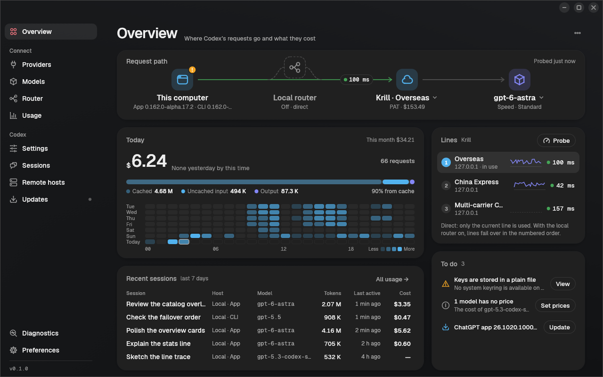
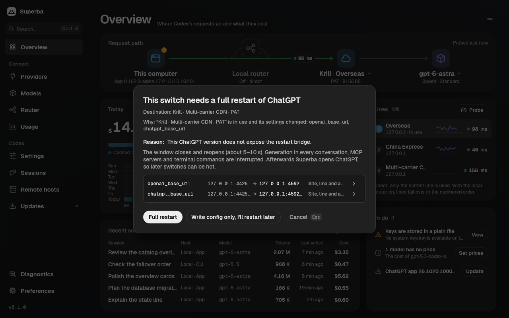
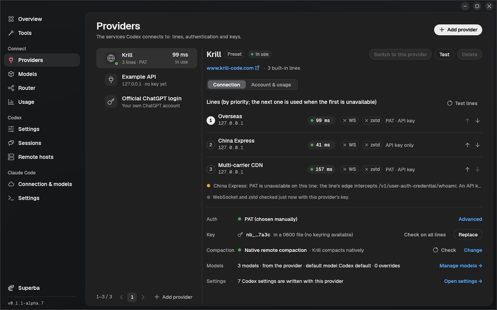
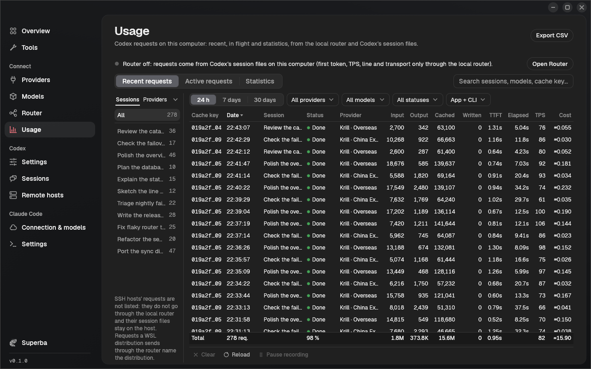
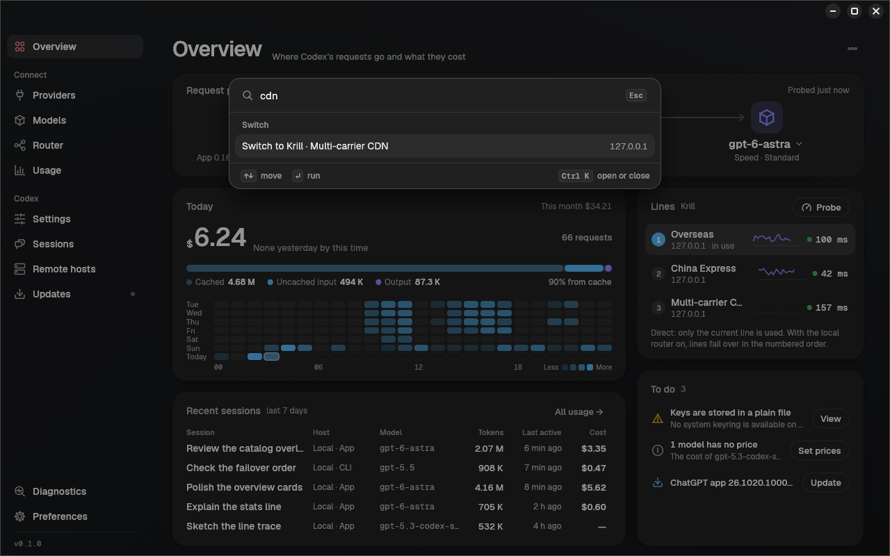

<p align="center"></p>

# Superba

**English** · [简体中文](README.zh-CN.md)

Superba is a small desktop launcher (with a headless CLI) that points
[OpenAI Codex](https://github.com/openai/codex) — the ChatGPT / Codex desktop app,
the `codex` CLI and the SSH remote hosts the app is connected to — at the
[Krill](https://www.krill-code.com) relay, at any OpenAI-compatible Responses API
site, or back to your official ChatGPT login. It switches lines and auth modes
**without closing the app**, keeps your conversations visible, and can put
everything back exactly as it was.

It runs on macOS, Linux and Windows and is written in Rust (egui GUI, Vercel
Geist look).



| Countdown before a hot switch | Providers: lines, authentication, key |
|---|---|
|  |  |
| **Usage and cost (Krill)** | **Command palette (Cmd/Ctrl+K)** |
|  |  |

> Screenshots come from the real binaries running against an isolated home and a
> local mock relay (`crates/superba-gui/tools/screenshots/shoot.py`); the account,
> key and usage shown are fake.

## Features

- **Hot switching.** Change the line (Krill: China Express, Overseas,
  Multi-carrier CDN) or the auth mode while the desktop app keeps running: the
  app's Codex core restarts in about a second, the window, the open
  conversation and the recents list stay, and the next turn goes to the new line
  with its full history.
- **Automatic authentication.** A Krill key is used as a personal access token
  (PAT) where that works and as a plain API key otherwise: on a line whose edge
  blocks the PAT endpoints, on a plain-http line, with a custom base URL, through
  the local router, or when the installed Codex (the app's bundled one or the CLI)
  is too old for PAT. The reason is always shown. PAT or API key can still be
  pinned under Advanced.
- **Profiles = connection + Codex settings.** A profile is a site, its lines in
  priority order (the next one is used when the first is down), the auth choice
  and the key, plus the `config.toml` settings Superba manages for it. Settings
  come from a catalog built from each Codex release's own schema and feature list
  (official English descriptions; Chinese ones are written by people), are
  checked against the Codex versions that read the configuration (app, CLI, each
  remote host), and every switch previews each changed key with its reason.
- **Any OpenAI-compatible site.** Add a Responses API site by its base URL, map
  Codex model names to the site's names, and probe it (latency, key, model list,
  one Responses call) before switching.
- **Import from cc-switch and AI Toolbox.** Their Codex providers (Krill lines
  become the Krill preset, other sites custom sites with their lines), previewed
  with conflicts and keys before anything is saved; their files are only read.
- **Models and speed.** The Models page (and `spb models`) lists a provider's
  models with their context window and auto-compact limit, lets you override
  them per model (shown as default or custom, validated, resettable), and the
  Standard / Fast / Ultrafast speed control shows what each tier does for the
  terminal and for the desktop app.
- **Codex and app versions.** The Updates page (and `spb codex`, `spb app`) shows
  the Codex the app, the CLI and each remote host run, installs verified Codex
  releases, can pin the desktop app to one Codex version, and checks for a newer
  ChatGPT desktop app build (the install command is shown, never run for you).
- **Superba updates itself, when you say so.** The Updates page, the Overview to-do,
  a dot in the sidebar and `spb self-update check` tell you when a newer Superba is
  published; `Update now` / `spb self-update install --yes` downloads the package
  for your system, verifies its size and SHA-256 against the release's
  `SHA256SUMS.txt`, replaces Superba in place (macOS bundle, Windows MSI,
  Linux binaries; manual steps if the folder is not writable) and restarts the
  local router service if it runs. Automatic checks (start-up and every 24 hours)
  and pre-releases are Preferences; nothing is installed without your click.
- **Account and usage.** Balance, plan and expiry from the standard billing
  endpoints of any key-based site; Krill also shows the account e-mail, daily
  cost and per-model usage (fetched on demand: Krill allows 10 usage requests an
  hour).
- **Local router (opt-in, off by default).** A small per-user background process
  on `127.0.0.1` that forwards this computer's Codex requests to Krill lines and
  your other sites with per-request failover and conversation stickiness. While
  it is on, your traffic goes through that local process. The official ChatGPT
  login is never routed and remote hosts stay direct; if the router dies while
  Superba (or `spb router watch`) runs, it switches Codex back to a direct line.
- **Usage.** Recent requests (Surge-style log with session names, provider,
  tokens, cache, cost) and statistics on the **Usage** page and with `spb usage`,
  also without the router: Superba reads the usage Codex writes into its session
  files (read-only, numbers only). With the router on, requests also show first
  token, TPS, the line that answered and the transport, and are listed once.
- **Safe by default.** Every switch is planned first (nothing is written while
  you look at the plan), shown with a 5-second countdown you can cancel with
  Esc, journaled while it runs, verified afterwards (new core process, file
  hashes, auth and line checks, window state) and rolled back automatically
  if verification fails.
- **Waits for your turns.** A turn in flight would lose its answer if the core
  restarted; Superba waits for running turns (or asks) before restarting.
- **Restore.** Back to the *original configuration* (byte for byte when nothing
  else changed), to your *official ChatGPT login* (stashed encrypted when
  Superba first replaced it), or to any earlier switch.
- **Session provider migration.** The app only lists conversations whose
  provider matches the current one. Users of the old Krill tutorial
  (`model_provider = "krill"`) can migrate those sessions to `openai` (and back),
  with backups, a ledger and exact rollback.
- **Remote hosts.** SSH hosts the app is connected to can be switched together
  with the local machine (over your system `ssh`, keys only through stdin).
- **Generic mode.** Any OpenAI-compatible Responses API site can be added by its
  base URL.
- **Doctor.** Finds stale Codex processes, foreign environment variables,
  unparseable configs, keyring problems and more.
- English and Simplified Chinese.

## Install

Pre-built archives are published on the releases page for:

| Platform | Archive |
|---|---|
| macOS 11+ (Apple silicon and Intel) | `superba-<version>-macos-universal.dmg` / `.zip` — signed and notarized `Superba.app` plus `spb` |
| Linux x86_64 / aarch64 (glibc) | `superba-<version>-linux-<arch>.tar.gz` (`superba`, `spb`, `superba-router`) |
| Linux x86_64, CLI only (static musl) | `spb-<version>-linux-x86_64-musl.tar.gz` (`spb`, `superba-router`) |
| Windows 10+ x86_64 | `superba-<version>-windows-x86_64.msi` — per-user installer (`superba.exe`, `spb.exe`, `superba-router.exe`) |

On Windows, run the `.msi` (no administrator rights needed): it installs to
`%LOCALAPPDATA%\Programs\Superba`, adds a Start-menu shortcut and puts `spb` on your
user `PATH` (open a new terminal afterwards). A newer `.msi` upgrades it in place;
**Settings > Apps** (or `msiexec /x`) removes it and also stops and removes the local
router's login startup entry. There is no zip for Windows. Silent install:
`msiexec /i superba-<version>-windows-x86_64.msi /qn`.

`superba-router` is the optional local router; keep it next to `superba` and
`spb` (on macOS it lives inside `Superba.app`, so move the app to Applications
before turning the router on). Each release has a `SHA256SUMS.txt`. To build from
source, see [Building](#building).

## Quick start (Krill)

1. Get a key on <https://www.krill-code.com>.
2. Start **Superba**. The first-run wizard detects the desktop app and the CLI,
   shows your current configuration (and any old `krill` sessions), asks for
   the key and measures the lines; authentication is automatic (PAT where the
   line supports it, else an API key, with the reason shown).
3. Review and press **Switch**. If the desktop app is running and was not
   started by Superba, Superba offers one full restart so it can hot-switch from
   then on (see below).
4. Later, click another line on the Overview page (or press Cmd/Ctrl+K and type
   its name); the countdown starts and the switch happens in place.

The same with the CLI:

```sh
# store the key in the OS keyring (read from stdin, never from argv)
# auth is automatic: PAT where the line supports it, else the API key (with the reason)
spb profile add krill --line overseas --line cdn --key-stdin
spb lines --probe                 # latency and PAT / API-key availability per line
spb switch --profile krill        # plan, countdown, switch, verify
spb launch                        # (re)open the desktop app through Superba
spb switch --line cdn             # later: hot switch to another line
spb account --usage               # balance, plan, expiry and recent usage of the key
spb settings list                 # Codex settings of the profile (from Codex's own schema)
```

Another OpenAI-compatible site:

```sh
spb site add myapi --name "My API" --base-url https://api.example.com/v1 \
  --map gpt-5.5=vendor/gpt-5.5    # optional: the site's name for a Codex model
spb profile add myapi --site myapi --key-stdin
spb site probe myapi --profile myapi --responses   # latency, key, models, one Responses call
spb switch --profile myapi
```

Back to where you started:

```sh
spb restore original              # the configuration before Superba took over (the latest takeover)
spb restore official              # your ChatGPT login (stashed, encrypted)
spb restore generation --generation 3
spb uninstall                     # restore and remove Superba's shell blocks
```

## Import from cc-switch and AI Toolbox

Set up Codex providers in [cc-switch](https://github.com/farion1231/cc-switch) or
[AI Toolbox](https://github.com/coulsontl/ai-toolbox) already? **Providers > Add >
Import from other tools** (also on the first-run wizard's provider step and in the
command palette) or `spb import` reads their configuration and imports the Codex
providers into Superba.

- **Read-only.** Superba only reads the other tool's store, also while that tool
  runs, and never writes to it: cc-switch's `~/.cc-switch/cc-switch.db` (schemas
  1 to 20; or the older `config.json`), AI Toolbox's `ai-toolbox.db` in its app
  data folder (schemas 4 to 29), honouring their data-folder overrides. A store of
  an unknown version or format (AI Toolbox's pre-0.9.2 SurrealDB folder) is
  skipped with the reason.
- **What a provider becomes.** An address on a Krill line becomes the Krill
  preset on that line; any other address a custom OpenAI-compatible site with its
  base URL, its lines (the tool's alternative addresses), model, reasoning effort
  and model mapping. Keys go into Superba's key storage (the OS keyring).
  Claude Code, Gemini and other non-Codex providers, ChatGPT logins and providers
  that only work through the other tool's local proxy are listed as not
  importable, with the reason.
- **Preview first.** Each provider shows what it becomes, whether its key comes
  along, and conflicts with providers you have (same name or same address): skip
  (the default), rename (import it next to the existing one) or update (key,
  address or line, model; its name and Codex settings stay). Nothing is written to
  Codex and nothing restarts: switch to an imported provider when you want it.

```sh
spb import ccs --dry-run                     # what would be imported, nothing written
spb import ai-toolbox --select "My Relay,Krill" --on-conflict rename
spb import ccs --json                        # the stores, the preview and the result
```

A key the other tool keeps in the system keychain or reads from an environment
variable is not copied: that provider is imported without a key, with a note, and
you add the key in Superba.

## How hot switching works

Codex reads `config.toml`, `auth.json` and its environment only when its
app-server process starts, so any switch needs a restart of that process. The
desktop app has an internal "restart the Codex core" message, and the only way
to send it from outside is the Chromium DevTools protocol. So:

1. Superba starts the desktop app itself with a debugging port on loopback only
   (`--remote-debugging-port=0` read back from `DevToolsActivePort` on Linux and
   macOS, a reserved free port on Windows), with `--remote-allow-origins` set to
   that exact origin, and records the port.
2. To switch, Superba writes the owned keys of `config.toml` and `auth.json`
   (atomically, journaled), checks the port really belongs to the app process,
   and asks the app's renderer to restart its Codex core.
3. Superba verifies a new core process started, the files are what it wrote, the
   key works on the line, and the window did not fall back to the login page.
   Otherwise it rolls back and restarts the core again.

Limits:

- Hot switching works only when Superba launched the app. Otherwise the first
  switch is a **full restart** (quit and relaunch), after which hot switching is
  available.
- Some changes always need a full restart: switching between your ChatGPT login
  and a key, PAT on a line whose auth address differs from the one the app was
  started with (the app reads `CODEX_AUTHAPI_BASE_URL` once at launch), and
  session migrations (all Codex processes must be closed).
- A turn that is running when the core restarts loses its answer. Superba waits
  for running turns by default; `--force` interrupts them.
- PAT needs an `https` line; Codex refuses a plain-http ChatGPT backend. A line
  whose edge intercepts the PAT endpoints (currently China Express) is used in
  API key mode, with an explanation.
- Terminal `codex` sessions and IDE extensions keep their configuration until
  they are restarted; Superba lists them as stale.
- Hot switching is verified on Linux (desktop app 26.10). On macOS and Windows it
  is implemented but still being verified; Superba falls back to a full restart
  when it cannot confirm the restart bridge.
- While the debugging port is open, other programs running as you, and on a
  multi-user machine other local users, can connect to it and control the app.
  Turn on **Safe mode** in Settings to launch without it (no hot switching).
  Running as root never opens the port. See [SECURITY.md](SECURITY.md).

## Local router (opt-in)

Router mode is off until you turn it on (**Router** page, or `spb router
enable`). It needs at least one member: a Krill or custom-site profile with its
own key.

- Superba installs `superba-router` as a per-user service (systemd user unit with
  an XDG autostart fallback on Linux, a LaunchAgent on macOS, a `HKCU\...\Run`
  entry on Windows) listening on `127.0.0.1` only, and points this computer's
  Codex at `http://127.0.0.1:<port>/backend-api/codex` in API key mode with a
  random local token. The router checks that token and sends each request to a
  member with that member's own key (a Krill key never goes to another site).
- Each request goes to the conversation's current line; a connection failure, a
  reset before any answer, 502/503/504 or an edge interception moves it to the
  next line of the member, then to the next member. 401, 403, 429 and other
  errors are passed back unchanged and never fail over. Streams (SSE,
  WebSocket) and compressed bodies pass through untouched.
- Turning it on or off goes through the normal switch flow with its preview.
  Editing the members of an installed router reloads it; before "Install and
  start" (or turning it on) the member list is only saved. While Codex is routed,
  Superba checks the router as long as the Superba window or `spb router watch`
  runs; if it stays down for 20 seconds, Superba switches Codex back to a direct
  line and turns router mode off (if that switch fails, it tries again).
- Deleting a member profile or giving it a new key updates the router's key
  file. `spb router disable` goes back to direct mode; `spb router uninstall` (or
  `spb uninstall`) removes the service and its key file.

See [SECURITY.md](SECURITY.md#the-local-router) for what the router can see.

## What Superba touches

| What | When | How it is restored |
|---|---|---|
| `~/.codex/config.toml` (or `$CODEX_HOME`) | every switch | only the keys Superba owns (`model_provider`, `openai_base_url`, `chatgpt_base_url`, the profile's model and the Codex settings it manages); a key the profile stops managing gets its earlier value back; comments, MCP servers, plugins and everything else stay byte-for-byte |
| `~/.codex/auth.json` | every switch | written with mode 0600; your ChatGPT login is stashed encrypted before it is replaced |
| Shell startup files | PAT mode only | a marked block exporting `CODEX_AUTHAPI_BASE_URL` (`~/.profile`, `~/.bashrc`, `~/.zshenv`, fish `conf.d`, `~/.config/environment.d` on Linux; `~/.zshenv` plus a LaunchAgent on macOS; `HKCU\Environment` on Windows). Old Krill tutorial lines are commented out and restored later |
| `state_5.sqlite`, `thread_history_*.sqlite`, `sessions/**/rollout-*.jsonl` | only when you migrate sessions | backups plus a ledger; `spb sessions rollback <id>` |
| Remote hosts' `~/.codex` and shell files | only for hosts you select | per-host backups on the host; `spb remote rollback <target>` |
| Router service (`superba-router.service`, `com.krill.superba.router` LaunchAgent, `SuperbaRouter` Run value) | only while the local router is installed | `spb router uninstall` / `spb uninstall` |
| cc-switch / AI Toolbox stores | only when you import from them | read only, never written (a database with pending changes is read from a private copy in Superba's cache, removed right after) |
| Superba's data dir | always | `~/.local/share/superba` (Linux), `~/Library/Application Support/com.krill-code.Superba` (macOS), `%APPDATA%\krill-code\Superba\data` (Windows); override with `SUPERBA_DATA_DIR` |

Keys you give Superba are stored in the OS keyring (Keychain, Credential
Manager, Secret Service), or in 0600 files in the data dir when no keyring is
available. Backups of logins and files are encrypted with ChaCha20-Poly1305.

If a switch is interrupted (crash, power loss), Superba finishes or rolls it
back the next time it starts (`spb recover` does it explicitly).

## CLI reference

`spb` is the headless CLI; `superba <command>` behaves the same. Every command
accepts `--json` (exactly one JSON document on stdout) and `--locale en|zh-CN`.

| Command | Purpose |
|---|---|
| `spb status` | applied profile, desktop app (install, CDP, auth address), CLI processes, remotes |
| `spb lines [--site ID] [--probe]` | lines and their latency / PAT / API key / edge status |
| `spb key set --profile P (--stdin \| --key-env VAR)` / `spb key check` | store or check a key |
| `spb profile list \| add \| edit \| remove \| use` | named profiles (site, line order, auth: auto / PAT / API key, key reference, model) |
| `spb site list \| add \| edit \| remove \| probe` | built-in and OpenAI-compatible sites, model mapping, line and key checks |
| `spb switch [--profile P] [--line L] [--auth pat\|apikey]` | plan and execute a switch (the preview lists every changed key and why) |
| `spb settings list \| get \| set \| reset \| forget \| migrate \| diff` | the Codex settings a profile manages, checked against the installed Codex |
| `spb router status \| install \| enable \| disable \| uninstall \| watch` | opt-in local router: failover across lines and sites, this computer only |
| `spb usage [log] [--provider P]` / `spb usage stats [--by model\|provider\|day\|session]` | this computer's Codex requests (the router's log merged with Codex's session files; works without the router); totals per provider (Krill, each custom site) with each of its lines |
| `spb account [--usage] [--days N] [--refresh]` | balance, plan and expiry; daily cost and per-model usage (Krill) |
| `spb restore [original\|official\|generation]` | restore |
| `spb launch [--restart]` | open (or fully restart) the desktop app through Superba |
| `spb sessions [scan \| migrate --from krill \| rollback ID]` | session providers |
| `spb remote list \| apply \| rollback` | SSH remote hosts |
| `spb import ccs\|ai-toolbox [--dry-run] [--select NAMES] [--on-conflict skip\|rename\|update]` | import Codex providers from cc-switch or AI Toolbox (their files are only read; Codex is not changed) |
| `spb doctor`, `spb recover`, `spb uninstall` | diagnostics, crash recovery, clean removal |

Useful flags for commands that execute a plan: `--dry-run` (show the plan only),
`--countdown N` (0–30 s, Ctrl-C cancels), `--yes` (confirm a full restart),
`--wait-turn` / `--force` (running turns), `--write-only` (write files, restart
nothing), `--remote TARGET` / `--no-local`.

Exit codes: `0` done, `1` error, `2` usage, `3` blocked, `4` needs an answer or
confirmation, `5` cancelled.

Environment: `SUPERBA_DATA_DIR` (data dir), `SUPERBA_LOCALE`, `SUPERBA_APP_PATH`
(use this desktop app install), `SUPERBA_APP_ARGS` (extra app arguments),
`SUPERBA_SECRET_BACKEND=keyring|file|auto`, `CODEX_HOME`.

## Krill

[Krill](https://www.krill-code.com) is the primary site Superba is built for:
its lines, the PAT / API-key modes, the line probes and the whoami / account
checks are built in. Accounts, keys, plans and billing live on
<https://www.krill-code.com>. Superba itself works with any OpenAI-compatible
Responses API site and with the official ChatGPT login as well.

## Building

Requirements: Rust 1.98 or newer, a C compiler (SQLite, zstd and the TLS
library are built from source). On Linux the GUI also needs the usual X11 /
Wayland headers:

```sh
sudo apt-get install -y libxkbcommon-dev libwayland-dev libxcb-render0-dev \
  libxcb-shape0-dev libxcb-xfixes0-dev libgl1-mesa-dev pkg-config
```

```sh
cargo build --release              # target/release/superba, spb and superba-router
cargo build --release -p superba-cli -p superba-router   # headless: no GUI libraries
cargo test --workspace
cargo clippy --workspace --all-targets -- -D warnings
python3 -I crates/superba-gui/tools/screenshots/shoot.py --bin-dir target/release
                                   # retake docs/screenshots (Xvfb, mock relay)
```

Read [ARCHITECTURE.md](ARCHITECTURE.md) for the crate layout and the switch
flow, and [CONTRIBUTING.md](CONTRIBUTING.md) before sending changes. Release
packaging and macOS signing are described in
[scripts/release/README.md](scripts/release/README.md).

## License

Licensed under either of [Apache License, Version 2.0](LICENSE-APACHE) or
[MIT license](LICENSE-MIT) at your option. The bundled Geist fonts are under the
SIL Open Font License 1.1 (`crates/superba-gui/assets/fonts/LICENSE-Geist-OFL.txt`).

Superba is an independent project. It is not affiliated with or endorsed by
OpenAI. "ChatGPT", "Codex" and "OpenAI" are trademarks of OpenAI.
