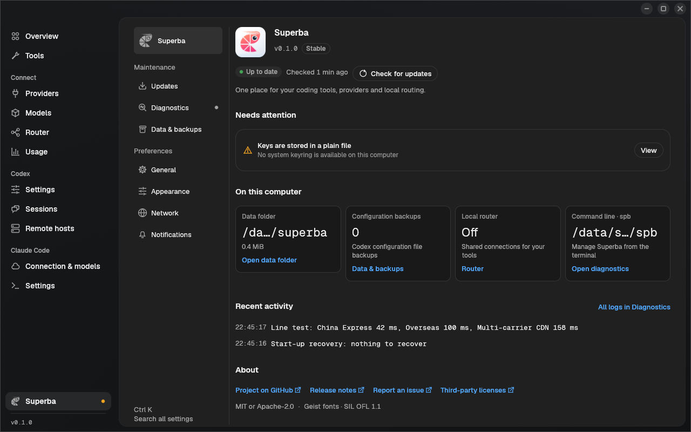
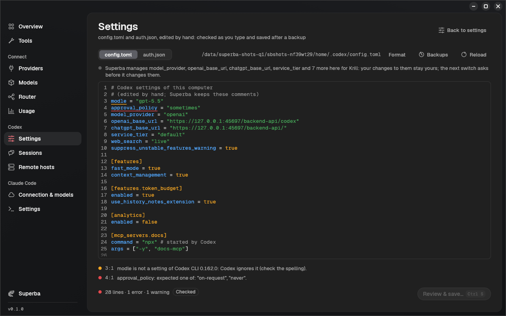
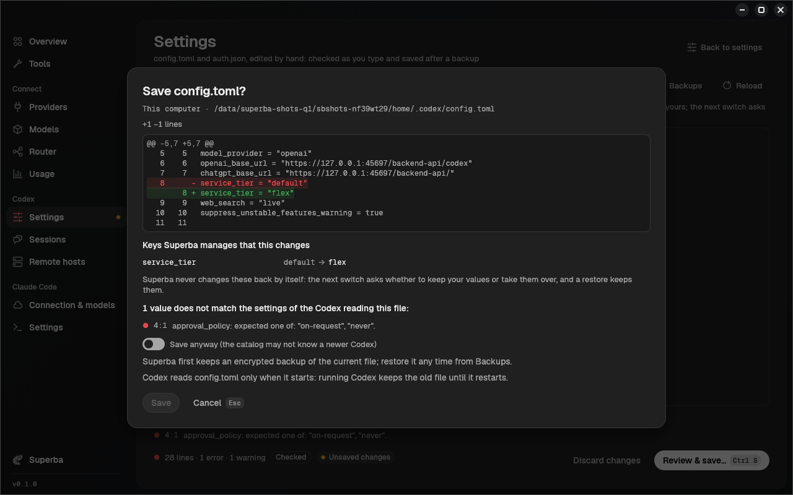

<p align="center"></p>

# Superba

**English** · [简体中文](README.zh-CN.md)

Superba is a small desktop launcher (with a headless CLI) that points
[OpenAI Codex](https://github.com/openai/codex) — the ChatGPT / Codex desktop app,
the `codex` CLI and the SSH remote hosts the app is connected to — at the
[Krill](https://www.krill-code.com) relay, at any OpenAI-compatible Responses API
site, or back to your official ChatGPT login. It switches lines and auth modes
**without closing the app**, keeps your conversations visible, and can put
everything back exactly as it was.

It runs on macOS, Linux and Windows and is written in Rust (egui GUI, Vercel
Geist look).


| Superba: updates, data and preferences | Providers: lines, authentication, key |
|---|---|
|  |  |
| **Usage and cost (Krill)** | **Command palette (Cmd/Ctrl+K)** |
|  |  |

> Screenshots come from the real binaries running against an isolated home and a
> local mock relay (`crates/superba-gui/tools/screenshots/shoot.py`); the account,
> key and usage shown are fake.

## Features

- **Hot switching.** Change the line (Krill: China Express, Overseas,
  Multi-carrier CDN) or the auth mode while the desktop app keeps running: the
  app's Codex core restarts in about a second, the window, the open
  conversation and the recents list stay, and the next turn goes to the new line
  with its full history.
- **Automatic authentication.** A Krill key is used as a personal access token
  (PAT) where that works and as a plain API key otherwise: on a line whose edge
  blocks the PAT endpoints, on a plain-http line, with a custom base URL, through
  the local router, or when the installed Codex (the app's bundled one or the CLI)
  is too old for PAT. The reason is always shown. PAT or API key can still be
  pinned under Advanced.
- **Profiles = connection + Codex settings.** A profile is a site, its lines in
  priority order (the next one is used when the first is down), the auth choice
  and the key, plus the `config.toml` settings Superba manages for it. Settings
  come from a catalog built from each Codex release's own schema and feature list
  (official English descriptions; Chinese ones are written by people), are
  checked against the Codex versions that read the configuration (app, CLI, each
  remote host), and every switch previews each changed key with its reason.
- **Any OpenAI-compatible site.** Add a Responses API site by its base URL, map
  Codex model names to the site's names, and probe it (latency, key, model list,
  one Responses call) before switching.
- **Import from cc-switch and AI Toolbox.** Their Codex providers (Krill lines
  become the Krill preset, other sites custom sites with their lines), previewed
  with conflicts and keys before anything is saved, and their recorded Codex
  usage history into the Usage page; their files are only read.
- **Remote compaction per provider.** Superba knows whether a provider can
  compact Codex conversations (checked, or set by you), warns before a switch to
  one that cannot or that cannot read conversations another provider compacted,
  and the local router keeps every compacted conversation with the provider that
  compacted it.
- **Models and speed.** The Models page (and `spb models`) lists a provider's
  models with their context window and auto-compact limit, lets you override
  them per model (shown as default or custom, validated, resettable), and the
  Standard / Fast / Ultrafast speed control shows what each tier does for the
  terminal and for the desktop app.
- **Codex and app versions.** Superba → Updates (and `spb codex`, `spb app`) shows
  the Codex the app, the CLI and each remote host run, installs verified Codex
  releases, can pin the desktop app to one Codex version, and checks for a newer
  ChatGPT desktop app build (the install command is shown, never run for you).
- **Superba updates itself, when you say so.** Superba → Updates, the Overview to-do,
  a dot in the sidebar and `spb self-update check` tell you when a newer Superba is
  published; `Update now` / `spb self-update install --yes` downloads the package
  for your system, verifies its size and SHA-256 against the release's
  `SHA256SUMS.txt`, replaces Superba in place (macOS bundle, Windows MSI,
  Linux binaries; manual steps if the folder is not writable) and restarts the
  local router service if it runs. Automatic checks (start-up and every 24 hours)
  and the update channel (Stable, or Preview with alpha, beta and release
  candidates; a preview build starts on Preview) are in Superba → Updates; an older version
  is never offered, and nothing is installed without your click.
- **Account and usage.** Balance, plan and expiry from the standard billing
  endpoints of any key-based site; Krill also shows the account e-mail, daily
  cost and per-model usage (fetched on demand: Krill allows 10 usage requests an
  hour).
- **Local router (opt-in, off by default).** A small per-user background process
  on `127.0.0.1` that forwards this computer's Codex requests to Krill lines and
  your other sites with per-request failover and conversation stickiness. While
  it is on, your traffic goes through that local process. The official ChatGPT
  login is never routed and remote hosts stay direct; if the router dies while
  Superba (or `spb router watch`) runs, it switches Codex back to a direct line.
  Choosing a line in router mode makes it that member's preferred line. New
  requests use the new order immediately; open streams continue. The Overview
  and Router pages show the preferred order separately from the latest actual
  upstream, including failover. You can also run `spb router line krill overseas`
  (use your profile id in place of `krill`) or reorder lines on the Providers page.
  Failed lines normally cool down for 5 seconds, doubling to at most 60 seconds.
  After recovery, new conversations try the preferred line; an active conversation
  keeps its working backup until it has been idle for 2 hours. Changing the line
  order clears these choices for new requests, without interrupting open streams.
- **Usage.** Recent requests (Surge-style log with session names, provider,
  tokens, cache, cost) and statistics on the **Usage** page and with `spb usage`,
  also without the router: Superba reads the usage Codex writes into its session
  files (read-only, numbers only). With the router on, requests also show first
  token, TPS, the line that answered and the transport, and are listed once.
- **Safe by default.** Every switch is planned first (nothing is written while
  you look at the plan), shown with a 5-second countdown you can cancel with
  Esc, journaled while it runs, verified afterwards (new core process, file
  hashes, auth and line checks, window state) and rolled back automatically
  if verification fails.
- **Waits for your turns.** A turn in flight would lose its answer if the core
  restarted; Superba waits for running turns (or asks) before restarting.
- **Restore.** Back to the *original configuration* (byte for byte when nothing
  else changed), to your *official ChatGPT login* (stashed encrypted when
  Superba first replaced it), or to any earlier switch.
- **Session provider migration.** The app only lists conversations whose
  provider matches the current one. Users of the old Krill tutorial
  (`model_provider = "krill"`) can migrate those sessions to `openai` (and back),
  with backups, a ledger and exact rollback. Codex in terminals and editors must
  be closed for that; Superba lists them and, if you ask, stops them for you
  (each is asked to exit first; ending one by force needs a second yes;
  `spb … --stop-codex [--force]` on the command line).
- **Remote hosts.** SSH hosts the app is connected to can be switched together
  with the local machine (over your system `ssh`, keys only through stdin).
- **Generic mode.** Any OpenAI-compatible Responses API site can be added by its
  base URL.
- **Codex in effect.** Codex reads its configuration only when it starts, so
  Superba shows, for every running Codex (the desktop app's core, codex in each
  terminal, `codex exec`, the editor extensions of VS Code / Cursor), whether it
  already uses what was written or still the previous configuration, whether a
  turn is running in it, and how it switches: Superba restarts the app's core;
  terminals and editors get the exact step (`codex resume --last`, "Developer:
  Restart Extension Host"; the editor is never closed). On the Overview's to-do,
  after every switch and in `spb status`.
- **Edit Codex's files by hand.** Settings → **Edit Codex files** (and `spb
  config edit`) opens `config.toml` or `auth.json` of this computer, a remote
  host or a WSL distribution in an editor that highlights TOML / JSON, checks
  every keystroke against the settings of the Codex versions reading that file,
  tidies it without losing a comment, hides the keys of `auth.json` until you
  show them, shows the diff before saving and keeps an encrypted backup of every
  version it replaces.
- **Doctor.** Finds stale Codex processes, foreign environment variables,
  unparseable configs, keyring problems and more.
- **Tray icon.** A Superba icon in the Windows notification area, the macOS
  menu bar and Linux trays (StatusNotifierItem, no GTK needed): open Superba,
  see and switch the provider and line in use, open or reopen ChatGPT through
  Superba, see the router and turn it off, quit. Superba → General: quit when
  the window is closed or keep running in the tray (Windows and Linux ask on the
  first close; macOS keeps running in the menu bar), and "Start hidden in the
  tray". Starting Superba again shows the running window. On a Linux desktop
  without a tray (GNOME without the AppIndicator extension) the setting is
  disabled and closing the window quits.
- **Notifications to your phone** (GH#12). When a task finishes, needs your
  approval or fails, Superba sends a short message to Telegram, a Feishu / Lark
  group, a WeCom group bot, a DingTalk bot, your personal WeChat (through the
  third-party relays ServerChan or PushPlus: personal WeChat has no official
  bot API), Bark, ntfy or your own webhook (signed). Codex reports finished
  tasks through its `notify` hook (Superba keeps a program you already had
  there) and approvals through a lifecycle hook you trust once; failed Codex
  tasks are found while Superba runs; Claude Code reports through its hooks
  (`spb notify hook claude-code`). The message names the project, the
  conversation, the computer, how long it ran and its tokens and cost; the
  start of the reply is sent only when you turn it on. Quiet hours, a rate
  limit, a minimum task length and a test button; tokens and webhook
  addresses stay in the key store. Superba → Notifications and `spb
  notify`.
- English and Simplified Chinese.

## Install

Pre-built archives are published on the releases page for:

| Platform | Archive |
|---|---|
| macOS 11+ (Apple silicon and Intel) | `superba-<version>-macos-universal.dmg` / `.zip` — signed and notarized `Superba.app` plus `spb` |
| Linux x86_64 / aarch64 (glibc) | `superba-<version>-linux-<arch>.tar.gz` (`superba`, `spb`, `superba-router`) |
| Linux x86_64, CLI only (static musl) | `spb-<version>-linux-x86_64-musl.tar.gz` (`spb`, `superba-router`) |
| Windows 10+ x86_64 | `superba-<version>-windows-x86_64.msi` — per-user installer (`superba.exe`, `spb.exe`, `superba-router.exe`) |

On macOS, open the `.dmg` and drag Superba onto Applications. `spb` is in the
image too, hidden in its window: copy it into a folder on your `PATH`, for example
`cp "/Volumes/Superba <version>/spb" ~/.local/bin/`, or take it from the `.zip`.

On Windows, run the `.msi` (no administrator rights needed): it installs to
`%LOCALAPPDATA%\Programs\Superba`, adds a Start-menu shortcut and puts `spb` on your
user `PATH` (open a new terminal afterwards). A newer `.msi` upgrades it in place;
**Settings > Apps** (or `msiexec /x`) removes it and also stops and removes the local
router's login startup entry. There is no zip for Windows. Silent install:
`msiexec /i superba-<version>-windows-x86_64.msi /qn`. The MSI also carries
`spb-linux-x86_64`, a static Linux build of `spb` that Superba runs inside WSL
distributions to migrate their sessions.

`superba-router` is the optional local router; keep it next to `superba` and
`spb` (on macOS it lives inside `Superba.app`, so move the app to Applications
before turning the router on). Each release has a `SHA256SUMS.txt`. To build from
source, see [Building](#building).

## Quick start (Krill)

1. Get a key on <https://www.krill-code.com>.
2. Start **Superba**. The first-run wizard detects the desktop app and the CLI,
   shows your current configuration (and any old `krill` sessions), asks for
   the key and measures the lines; authentication is automatic (PAT where the
   line supports it, else an API key, with the reason shown).
3. Review and press **Switch**. If the desktop app is running and was not
   started by Superba, Superba offers one full restart so it can hot-switch from
   then on (see below).
4. Later, click another line on the Overview page (or press Cmd/Ctrl+K and type
   its name); the countdown starts and the switch happens in place.

The same with the CLI:

```sh
# store the key in the OS keyring (read from stdin, never from argv)
# auth is automatic: PAT where the line supports it, else the API key (with the reason)
spb profile add krill --line overseas --line cdn --key-stdin
spb lines --probe                 # latency and PAT / API-key availability per line
spb switch --profile krill        # plan, countdown, switch, verify
spb launch                        # (re)open the desktop app through Superba
spb switch --line cdn             # later: hot switch to another line
spb account --usage               # balance, plan, expiry and recent usage of the key
spb settings list                 # this computer's Codex settings (config.toml, Codex's own schema)
```

Another OpenAI-compatible site:

```sh
spb site add myapi --name "My API" --base-url https://api.example.com/v1 \
  --map gpt-5.5=vendor/gpt-5.5    # optional: the site's name for a Codex model
spb profile add myapi --site myapi --key-stdin
spb site probe myapi --profile myapi --responses   # latency, key, models, one Responses call
spb switch --profile myapi
```

Back to where you started:

```sh
spb restore original              # the configuration before Superba took over (the latest takeover)
spb restore official              # your ChatGPT login (stashed, encrypted)
spb restore generation --generation 3
spb uninstall                     # restore and remove Superba's shell blocks
```

Restoring the original defaults to `--provider reverse-migrate`: the configuration
returns byte for byte (unless another tool changed it), and sessions move back to
the original provider so they stay visible in Codex. The GUI offers this as its
default choice. `--provider keep-openai` deliberately retains `model_provider =
"openai"` and `openai_base_url` pointing to the original address; `--provider
no-migrate` restores the configuration without moving sessions, which hides
sessions still under `openai` when the original provider differs.

## Import from cc-switch and AI Toolbox

Set up Codex providers in [cc-switch](https://github.com/farion1231/cc-switch) or
[AI Toolbox](https://github.com/coulsontl/ai-toolbox) already? **Providers > Add >
Import from other tools** (also on the first-run wizard's provider step and in the
command palette) or `spb import` reads their configuration and imports the Codex
providers into Superba.

- **Read-only.** Superba only reads the other tool's store, also while that tool
  runs, and never writes to it: cc-switch's `~/.cc-switch/cc-switch.db` (schemas
  1 to 20; or the older `config.json`), AI Toolbox's `ai-toolbox.db` in its app
  data folder (schemas 4 to 29), honouring their data-folder overrides. A store of
  an unknown version or format (AI Toolbox's pre-0.9.2 SurrealDB folder) is
  skipped with the reason.
- **What a provider becomes.** An address on a Krill line becomes the Krill
  preset on that line; any other address a custom OpenAI-compatible site with its
  base URL, its lines (the tool's alternative addresses), model, reasoning effort
  and model mapping. Keys go into Superba's key storage (the OS keyring).
  Claude Code, Gemini and other non-Codex providers, ChatGPT logins and providers
  that only work through the other tool's local proxy are listed as not
  importable, with the reason.
- **Preview first.** Each provider shows what it becomes, whether its key comes
  along, and conflicts with providers you have (same name or same address): skip
  (the default), rename (import it next to the existing one) or update (key,
  address or line, model; its name and Codex settings stay). Nothing is written to
  Codex and nothing restarts: switch to an imported provider when you want it.

```sh
spb import ccs --dry-run                     # what would be imported, nothing written
spb import ai-toolbox --select "My Relay,Krill" --on-conflict rename
spb import ccs --json                        # the stores, the preview and the result
```

A key the other tool keeps in the system keychain or reads from an environment
variable is not copied: that provider is imported without a key, with a note, and
you add the key in Superba.

### Usage history

The same dialog shows, per tool, the Codex usage history it recorded (its local
proxy's request log and the daily totals it keeps for older days) with the
number of requests, the date range and the cost the tool recorded; **Import
usage history** copies it into Superba's Usage page, where those rows say
"Imported from CC Switch / AI Toolbox" and the source filter selects them
(`spb import usage` does the same).

- **Read-only and once.** The tool's database is only read. Requests keep the
  tool's own ids, so importing again adds only what is new. Costs stay as the
  tool recorded them (a request it recorded no cost for shows none); error texts
  and prompts are never copied. Rows of Claude Code and other tools are counted,
  not imported.
- **Never twice.** Both tools can also read Codex's own session files, which
  Superba reads itself: those rows are imported only for conversations whose
  files are gone (and such daily totals only for days before Superba's oldest
  session file).
- **Daily totals** stand for days the tool no longer keeps per request; they
  count in the statistics, not in the request list. `--remove` takes a tool's
  imported rows out again.

```sh
spb import usage ccs --dry-run               # counts, date range, recorded cost; nothing written
spb import usage ai-toolbox                  # import (again: only what is new)
spb usage log --since 90d --source ccs       # the imported rows
spb import usage ccs --remove                # take them out again
```

## Remote compaction

Codex compacts a long conversation by sending it to the provider with a
`compaction_trigger` item (over HTTP or WebSocket) and keeps the provider's
single encrypted `compaction` item instead of the old history; only that
provider can read it later. For the provider Superba configures (`openai`),
Codex always compacts this way: it has no setting that makes it compact locally
(that switch exists only for custom provider ids, which Superba never writes,
because Codex lists sessions per provider id).

- **Per provider.** The Connection tab shows whether a provider compacts
  natively, does not, or was not checked yet. **Check** sends one tiny compaction
  request the way Codex does (a few tokens); a custom site nothing is known about
  is checked once when you open it (again after a week, or a day when the answer
  did not tell). Krill compacts natively. **Change** overrides the result
  (Automatic / Native / Not supported); `spb profile compaction <id> [--check]`
  and `spb profile edit <id> --compaction auto|native|unsupported` do the same.
- **Direct mode.** A native provider's requests pass through untouched. Before a
  switch to a provider that cannot compact, the preview says so (a conversation
  that fills its context window cannot be compacted there: start a new one), and
  it counts the conversations of the last 7 days that another site's provider
  compacted: continuing them on the new provider fails or loses their context.
- **Router mode.** Compaction requests skip members that cannot compact (the
  compaction goes to one that can, and the conversation stays there); a
  compacted conversation goes only to the member that made its compaction item
  and never fails over to another member (it gets `compaction_owner_unavailable`
  while that member is down); with no member left the router answers
  `compaction_unsupported` with an explanation. WebSocket sessions reconnect to
  the right member on their own. The router keeps only fingerprints of
  compaction items and member ids (`router/compactions.json`), never content.

## Conversations started on another provider

Every Codex conversation carries content its provider encrypted for itself:
hidden reasoning, a sub-agent's task, encrypted tool results, compacted
history. Only that provider can read it. Because Superba configures every
provider as Codex's own `openai` provider, Codex lists every conversation
under every profile, and continuing one on a provider that cannot read its
content stops with `invalid_encrypted_content` ("The encrypted content for item
amsg_… could not be verified", "Encrypted function output content could not be
decrypted or decoded") on every turn. A sub-agent spawned on a provider that
is not an OpenAI backend makes this certain: Codex stores its task as encrypted
content even when it is plain text. Superba treats the official login and
Krill as one provider here (both run on the ChatGPT Codex backend); each
compatible site is its own.

- **Router mode** repairs these requests: when a provider refuses content, the
  router leaves out exactly what it cannot read (hidden reasoning goes, a
  sub-agent task that is plain text stays as text, an encrypted payload
  becomes a short note) and sends the request once more; later turns of the
  conversation leave the same items out before they leave, so the conversation
  keeps working and keeps its prompt cache. The Router page lists each repair,
  and the request detail says what was left out. A sub-agent whose own task the
  provider cannot read gets `encrypted_task_unreadable` with an explanation
  instead of running without its task.
- **Direct mode.** Superba is not in the path, so it warns: before a switch to a
  provider that cannot read the content, the preview counts the conversations
  of the last 7 days last continued elsewhere; afterwards the Overview (and
  `spb status`) names conversations that stopped for it in the last day.
  Continue such a conversation on the provider it was started with, start a new
  conversation (`/fork` copies the same content), or turn on the router.

## Using Superba next to cc-switch or AI Toolbox

Superba owns exactly what its last switch wrote: the keys in `config.toml` listed
under [What Superba touches](#what-superba-touches), the credential in
`auth.json` and its `CODEX_AUTHAPI_BASE_URL` values. When something else changes
one of them afterwards (cc-switch or AI Toolbox switching Codex to one of their
providers, the Codex app's model picker, `codex login`, a hand edit), Superba
notices and does not overwrite it without asking:

- **Seen at start-up, before every write and while the window is open.** The
  Overview lists the change with a **Review** button, and a dialog opens once per
  new state of the files: who most likely made it (cc-switch or AI Toolbox are
  named with their provider when their own store or their markers show it, else
  "Codex's own sign-in", "the Codex app or a hand edit" or "another program or a
  hand edit"), each changed key with Superba's value and the current one, and the
  credential (`PAT …1111 → no auth.json`; keys are never shown). `spb status` and
  `spb doctor` show the same.
- **Take over again, let the other tool manage it, or not now.** *Take over
  again* re-applies your profile over the changes (with the usual plan and
  countdown); *Let cc-switch manage it* hands off (below); *Not now* leaves
  everything as it is. A switch planned while such changes exist asks the same
  question (Esc cancels; nothing is written); `spb switch --take-over` answers it
  on the command line, and `spb` asks at a terminal.
- **Restoring never undoes the other tool's work.** Restore (original, official
  or a generation), uninstall and the router's automatic fallback put back only
  what Superba still manages and list what they kept and why; `spb restore
  --take-over` / `spb uninstall --take-over` restore those keys too. Quitting
  Superba writes nothing.
- **Hand-off.** *Let … manage it* (or `spb hand-off`) makes Superba stop managing
  Codex: the keys it still owns go back to how you had them (for example its
  `chatgpt_base_url`, which cc-switch does not manage and which would send
  ChatGPT traffic to Krill), everything the other tool changed stays, its
  `CODEX_AUTHAPI_BASE_URL` values are removed where nobody changed them, and an
  encrypted copy of both files is kept with the generation history. Nothing is
  restarted and no session is migrated. Superba then owns nothing and the
  Overview shows "Managed by cc-switch"; switching to a profile later takes over
  again from a fresh baseline, so a later restore gives the other tool's
  configuration back.

```sh
spb status                       # what changed outside Superba and who most likely did it
spb switch --take-over           # re-apply the profile over those changes
spb hand-off [--to cc-switch|ai-toolbox|other]   # let the other tool manage Codex
spb restore --take-over          # restore the original also where another tool changed it
```

Superba reads the other tools' stores only to say who made a change; it never
writes to them, and two tools managing the same keys at the same time is not
supported: hand off, or take over.

## Editing config.toml and auth.json by hand

Settings → **Edit Codex files** (also in the command palette: *Edit config.toml*,
*Edit auth.json*, *Restore config.toml from a backup*) edits Codex's own files
directly, for this computer or, from the **Where** menu, for a remote host or a
WSL distribution Superba manages.



- **Checked as you type.** A TOML or JSON syntax error is underlined with its
  line and column and the file cannot be saved (Codex could not start with it).
  `config.toml` is also checked against the settings catalog of every Codex that
  reads it (the app's bundled Codex and the CLI here, the host's Codex there): a
  value of the wrong type is an error you can still save with *Save anyway* (the
  catalog may not know a newer Codex yet), a key no Codex knows, a deprecated key
  and an old name are warnings. `auth.json` is checked for the fields Codex
  reads. Click a problem to jump to it.
- **Format** tidies spacing and blank lines; comments, values and their order
  stay exactly as they are.
- **Secrets stay hidden.** The API key, PAT and login tokens of `auth.json` are
  shown as `••••••••••••1234` until **Show secrets**; you can edit everything
  else without revealing them, and a placeholder changed only partly is refused.
  Keys never reach logs, diffs (unless shown) or `--json` output.
- **Review & save** (Ctrl/Cmd+S) shows the diff, the keys Superba manages that
  the edit changes, and saves only when the file is still what you opened.
  The file it replaces is backed up first (encrypted, the newest 50 per file).
- **Your edit stays yours.** A key Superba manages that you changed is your
  value: Superba never changes it back by itself, the next switch asks whether to
  keep it or take it over, and a restore keeps it (as with any change made
  outside Superba, see above; the Overview lists it as your edit).
- **What needs a restart.** Codex reads these files only when it starts; after a
  save Superba names every running Codex still on the old file, and **Codex in
  effect** says how each one picks up the new one.
- **Backups.** Every backup of the file (the editor's, the copy Superba keeps
  before each switch, and the original from before Superba first wrote it), each
  with a diff to the editor; restoring one is saved like an edit, after a backup
  of its own.



```sh
spb config edit [config|auth] [--host H]   # $VISUAL / $EDITOR (notepad on Windows), checked when it closes
spb config check [config|auth]             # check the file as it is
spb config backups [--file config|auth]    # every backup with its id, time and source
spb config restore <id>                    # the diff, then put it back
```

`spb config edit` opens a private copy, checks it when the editor closes (and
offers to edit again on a syntax error), shows the diff (keys masked unless
`--show-secrets`) and asks before saving (`--yes` to skip the question,
`--force` to save values of the wrong type).

## How hot switching works

Codex reads `config.toml`, `auth.json` and its environment only when its
app-server process starts, so any switch needs a restart of that process. The
desktop app has an internal "restart the Codex core" message, and the only way
to send it from outside is the Chromium DevTools protocol. So:

1. Superba starts the desktop app itself with a debugging port on loopback only
   (`--remote-debugging-port=0` read back from `DevToolsActivePort` on Linux and
   macOS, a reserved free port on Windows), with `--remote-allow-origins` set to
   that exact origin, and records the port.
2. To switch, Superba writes the owned keys of `config.toml` and `auth.json`
   (atomically, journaled), checks the port really belongs to the app process,
   and asks the app's renderer to restart its Codex core.
3. Superba verifies a new core process started, the files are what it wrote, the
   key works on the line, and the window did not fall back to the login page.
   Otherwise it rolls back and restarts the core again.

Limits:

- Hot switching works only when Superba launched the app. Otherwise the first
  switch is a **full restart** (quit and relaunch), after which hot switching is
  available. To start ChatGPT that way from the beginning, see below.
- Some changes always need a full restart: switching between your ChatGPT login
  and a key, PAT on a line whose auth address differs from the one the app was
  started with (the app reads `CODEX_AUTHAPI_BASE_URL` once at launch), and
  session migrations (all Codex processes must be closed).
- A turn that is running when the core restarts loses its answer. Superba waits
  for running turns by default; `--force` interrupts them.
- PAT needs an `https` line; Codex refuses a plain-http ChatGPT backend. A line
  whose edge intercepts the PAT endpoints (currently China Express) is used in
  API key mode, with an explanation.
- Terminal `codex` sessions and IDE extensions keep their configuration until
  they are restarted; Superba lists them as stale.
- Hot switching is verified on Linux (desktop app 26.10). On macOS and Windows it
  is implemented but still being verified; Superba falls back to a full restart
  when it cannot confirm the restart bridge.
- While the debugging port is open, other programs running as you, and on a
  multi-user machine other local users, can connect to it and control the app.
  Turn on **Safe mode** in Settings to launch without it (no hot switching).
  Running as root never opens the port. See [SECURITY.md](SECURITY.md).

### Opening ChatGPT through Superba

ChatGPT opened from its own icon (Start menu, Dock, launcher) cannot be
hot-switched until Superba reopens it. Ways to open it through Superba:

- **Overview**: the route card shows **Open ChatGPT with Superba** while ChatGPT
  is not running, and **Reopen with Superba (enables hot switching)** while it
  runs without what hot switching needs (a full restart, previewed and confirmed;
  running turns are waited for). Nothing is shown once hot switching works. The
  same action is in the command palette (Cmd/Ctrl+K, type "chatgpt").
- **Windows**: the MSI adds a Start-menu shortcut **ChatGPT (Superba)**
  (`superba.exe --launch-chatgpt`). With Superba already open, that window does it
  and no other window opens; otherwise ChatGPT opens without a Superba window
  (Superba shows only to confirm a reopen or to report an error). Clicking it while
  ChatGPT is open through Superba brings ChatGPT to the front.
- **Linux**: the desktop file has the action **Open ChatGPT with Superba**
  (right-click Superba in the launcher), running `superba --launch-chatgpt`.
- **macOS**: use the Overview, the palette or `spb launch` (no Dock menu item yet).
- **Superba → General → Open ChatGPT through Superba when Superba starts**
  (off by default) opens ChatGPT whenever Superba opens and ChatGPT is not running;
  a running ChatGPT is left alone.
- **CLI**: `spb launch` opens ChatGPT through Superba (and brings it to the front
  if Superba opened it already); `spb launch --restart` reopens a ChatGPT that was
  started elsewhere (a full restart, with the same plan and confirmation as a
  switch).

## Local router (opt-in)

Router mode is off until you turn it on (**Router** page, or `spb router
enable`). It needs at least one member: a Krill or custom-site profile with its
own key. The router sends that key as an API key, also for a profile that uses a
personal access token when switched directly (that choice stays for direct
switches).

- Superba installs `superba-router` as a per-user service (systemd user unit with
  an XDG autostart fallback on Linux, a LaunchAgent on macOS, a `HKCU\...\Run`
  entry on Windows) listening on `127.0.0.1` only, and points this computer's
  Codex at `http://127.0.0.1:<port>/backend-api/codex` in API key mode with a
  random local token. The router checks that token and sends each request to a
  member with that member's own key (a Krill key never goes to another site).
- Each request goes to the conversation's current line; a connection failure, a
  reset before any answer, 502/503/504 or an edge interception moves it to the
  next line of the member, then to the next member. 401, 403, 429 and other
  errors are passed back unchanged and never fail over. Streams (SSE,
  WebSocket) and compressed bodies pass through untouched.
- Turning it on or off goes through the normal switch flow with its preview.
  Editing the members of an installed router reloads it; before "Install and
  start" (or turning it on) the member list is only saved. While Codex is routed,
  Superba checks the router as long as the Superba window or `spb router watch`
  runs; if it stays down for 20 seconds, Superba switches Codex back to a direct
  line and turns router mode off (if that switch fails, it tries again).
- Deleting a member profile or giving it a new key updates the router's key
  file. `spb router disable` goes back to direct mode; `spb router uninstall` (or
  `spb uninstall`) removes the service and its key file.

See [SECURITY.md](SECURITY.md#the-local-router) for what the router can see.

## What Superba touches

| What | When | How it is restored |
|---|---|---|
| `~/.codex/config.toml` (or `$CODEX_HOME`) | every switch | only the keys Superba owns (`model_provider`, `openai_base_url`, `chatgpt_base_url`, the profile's model and the Codex settings it manages); a key the profile stops managing gets its earlier value back; comments, MCP servers, plugins and everything else stay byte-for-byte; a key another program changed after Superba wrote it is kept (see above) |
| `~/.codex/auth.json` | every switch | written with mode 0600; your ChatGPT login is stashed encrypted before it is replaced; a credential another program put there is kept by restores and replaced by a switch only when you take it over |
| Shell startup files | PAT mode only | a marked block exporting `CODEX_AUTHAPI_BASE_URL` (Linux: `~/.profile` and `~/.config/environment.d/60-superba.conf`, plus `~/.bashrc`, `~/.bash_profile`, `~/.zshenv` (in `$ZDOTDIR` when set) and fish `conf.d/superba.fish` when they exist or belong to your shell; macOS: `~/.zshenv`, the same bash and fish files, and the LaunchAgent `~/Library/LaunchAgents/com.krill-code.superba.env.codex-authapi-base-url.plist`; Windows: the user variable in `HKCU\Environment`, no file). Old Krill tutorial lines are commented out and restored later |
| `state_5.sqlite`, `thread_history_*.sqlite`, `sessions/**/rollout-*.jsonl` | only when you migrate sessions | backups plus a ledger; `spb sessions rollback <id>` |
| Remote hosts' `~/.codex` and shell files | only for hosts you select | per-host backups on the host; `spb remote rollback <target>` |
| Router service (Linux: `~/.config/systemd/user/superba-router.service`; macOS: `~/Library/LaunchAgents/com.krill.superba.router.plist`; Windows: the `SuperbaRouter` value under `HKCU\Software\Microsoft\Windows\CurrentVersion\Run`) | only while the local router is installed | `spb router uninstall` / `spb uninstall` |
| `config.toml` / `auth.json` you edit in Superba (here, on a remote host or in WSL) | only when you save an edit or restore a backup | the file it replaces is backed up first, encrypted, in the data dir (`backups/editor/`, the newest 50 per file); Settings → Edit Codex files → Backups or `spb config restore <id>` |
| cc-switch / AI Toolbox stores | only when you import from them | read only, never written (a database with pending changes is read from a private copy in Superba's cache, removed right after) |
| Superba's data dir | always | `~/.local/share/superba` (Linux; `$XDG_DATA_HOME/superba` when set), `~/Library/Application Support/com.krill-code.Superba` (macOS), `%LOCALAPPDATA%\krill-code\Superba\data` (Windows: the local, non-roaming profile); Superba → Data or `spb data move` moves it and leaves a small pointer at this fixed location. `SUPERBA_DATA_DIR` overrides the fixed pointer directory. |

Keys you give Superba are stored in the OS keyring (Keychain, Credential
Manager, Secret Service), or in 0600 files in the data dir when no keyring is
available. Backups of logins and files are encrypted with ChaCha20-Poly1305.

If a switch is interrupted (crash, power loss), Superba finishes or rolls it
back the next time it starts (`spb recover` does it explicitly).

[Data location and disk use](docs/data-location.md) describes the storage categories,
retention, cleanup and relocation guarantees. Codex's own `CODEX_HOME/sessions`
is measured separately and stays in place when Superba's data moves.

## CLI reference

`spb` is the headless CLI; `superba <command>` behaves the same. Every command
accepts `--json` (exactly one JSON document on stdout) and `--locale en|zh-CN`.

| Command | Purpose |
|---|---|
| `spb status` | applied profile, desktop app (install, CDP, auth address), CLI processes, remotes |
| `spb data where \| move <dir> \| usage` | active Superba directory, verified relocation to an empty local directory, and category sizes with Codex sessions counted separately |
| `spb lines [--site ID] [--probe]` | lines and their latency / PAT / API key / edge status |
| `spb key set --profile P (--stdin \| --key-env VAR)` / `spb key check` | store or check a key |
| `spb profile list \| add \| edit \| remove \| use` | named profiles (site, line order, auth: auto / PAT / API key, key reference, model, `--compaction auto\|native\|unsupported`) |
| `spb profile compaction ID [--check]` | the provider's remote compaction support (`--check` asks the provider: a few tokens) |
| `spb site list \| add \| edit \| remove \| probe` | built-in and OpenAI-compatible sites, model mapping, line and key checks |
| `spb switch [--profile P] [--line L] [--auth pat\|apikey]` | plan and execute a switch (the preview lists every changed key and why) |
| `spb settings list \| get \| set \| reset \| forget \| migrate \| diff` | this computer's Codex settings (`config.toml`); edits are stored with the applied provider, `--profile` for one provider's own settings; checked against the installed Codex |
| `spb router status \| install \| enable \| disable \| uninstall \| watch` | opt-in local router: failover across lines and sites, this computer only |
| `spb router line <provider> <line>` | make a member's line preferred; apply to the running router immediately |
| `spb usage [log] [--provider P] [--source router\|rollout\|ccs\|ai-toolbox]` / `spb usage stats [--by model\|provider\|day\|session] [--source …]` | this computer's Codex requests (the router's log merged with Codex's session files; works without the router); totals per provider (Krill, each custom site) with each of its lines |
| `spb account [--usage] [--days N] [--refresh]` | balance, plan and expiry; daily cost and per-model usage (Krill) |
| `spb restore [original\|official\|generation] [--take-over]` | restore (what another tool changed is kept unless `--take-over`) |
| `spb hand-off [--to cc-switch\|ai-toolbox\|other]` | let another tool manage Codex: release what Superba owns, keep the other tool's changes and a backup |
| `spb launch [--restart]` | open (or fully restart) the desktop app through Superba, so it can be hot-switched |
| `spb sessions [scan \| migrate --from krill \| rollback ID]` | session providers |
| `spb remote list \| apply \| rollback` | SSH remote hosts |
| `spb import ccs\|ai-toolbox [--dry-run] [--select NAMES] [--on-conflict skip\|rename\|update]` | import Codex providers from cc-switch or AI Toolbox (their files are only read; Codex is not changed) |
| `spb import usage ccs\|ai-toolbox [--dry-run] [--remove]` | import the Codex usage history cc-switch or AI Toolbox recorded into the Usage page (read-only; once per request) |
| `spb config edit [config\|auth] [--host H] [--yes] [--force] [--show-secrets]` | edit Codex's `config.toml` / `auth.json` by hand in `$VISUAL` / `$EDITOR`: checked when the editor closes, the diff, a backup before saving |
| `spb config check \| backups \| restore ID` | check a file as it is; list every backup; put one back (the diff first) |
| `spb doctor`, `spb recover`, `spb uninstall` | diagnostics, crash recovery, clean removal |

`spb switch --take-over` (also `profile use`) takes over keys and the credential
another tool changed; `--keep-key PATH` keeps a single one.

Useful flags for commands that execute a plan: `--dry-run` (show the plan only),
`--countdown N` (0–30 s, Ctrl-C cancels), `--yes` (confirm a full restart),
`--wait-turn` / `--force` (running turns), `--write-only` (write files, restart
nothing), `--remote TARGET` / `--no-local`.

Exit codes: `0` done, `1` error, `2` usage, `3` blocked, `4` needs an answer or
confirmation, `5` cancelled.

Environment: `SUPERBA_DATA_DIR` (fixed data/pointer directory), `SUPERBA_LOCALE`, `SUPERBA_APP_PATH`
(use this desktop app install), `SUPERBA_APP_ARGS` (extra app arguments),
`SUPERBA_SECRET_BACKEND=keyring|file|auto`, `CODEX_HOME`, `VISUAL` / `EDITOR`
(`spb config edit`).

## Krill

[Krill](https://www.krill-code.com) is the primary site Superba is built for:
its lines, the PAT / API-key modes, the line probes and the whoami / account
checks are built in. Accounts, keys, plans and billing live on
<https://www.krill-code.com>. Superba itself works with any OpenAI-compatible
Responses API site and with the official ChatGPT login as well.

## Building

Requirements: Rust 1.98 or newer, a C compiler (SQLite, zstd and the TLS
library are built from source). On Linux the GUI also needs the usual X11 /
Wayland headers:

```sh
sudo apt-get install -y libxkbcommon-dev libwayland-dev libxcb-render0-dev \
  libxcb-shape0-dev libxcb-xfixes0-dev libgl1-mesa-dev pkg-config
```

```sh
cargo build --release              # target/release/superba, spb and superba-router
cargo build --release -p superba-cli -p superba-router   # headless: no GUI libraries
cargo test --workspace
cargo clippy --workspace --all-targets -- -D warnings
python3 -I crates/superba-gui/tools/screenshots/shoot.py --bin-dir target/release
                                   # retake docs/screenshots (Xvfb, mock relay)
```

Read [ARCHITECTURE.md](ARCHITECTURE.md) for the crate layout and the switch
flow, and [CONTRIBUTING.md](CONTRIBUTING.md) before sending changes. Release
packaging and macOS signing are described in
[scripts/release/README.md](scripts/release/README.md).

## License

Licensed under either of [Apache License, Version 2.0](LICENSE-APACHE) or
[MIT license](LICENSE-MIT) at your option. The bundled Geist fonts are under the
SIL Open Font License 1.1 (`crates/superba-gui/assets/fonts/LICENSE-Geist-OFL.txt`).

Superba is an independent project. It is not affiliated with or endorsed by
OpenAI. "ChatGPT", "Codex" and "OpenAI" are trademarks of OpenAI.
