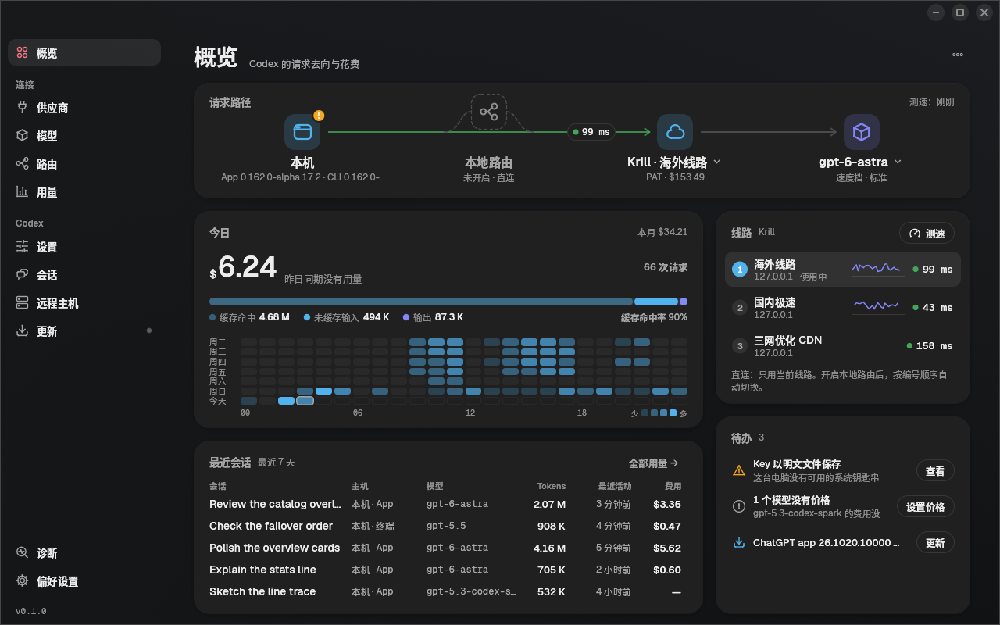
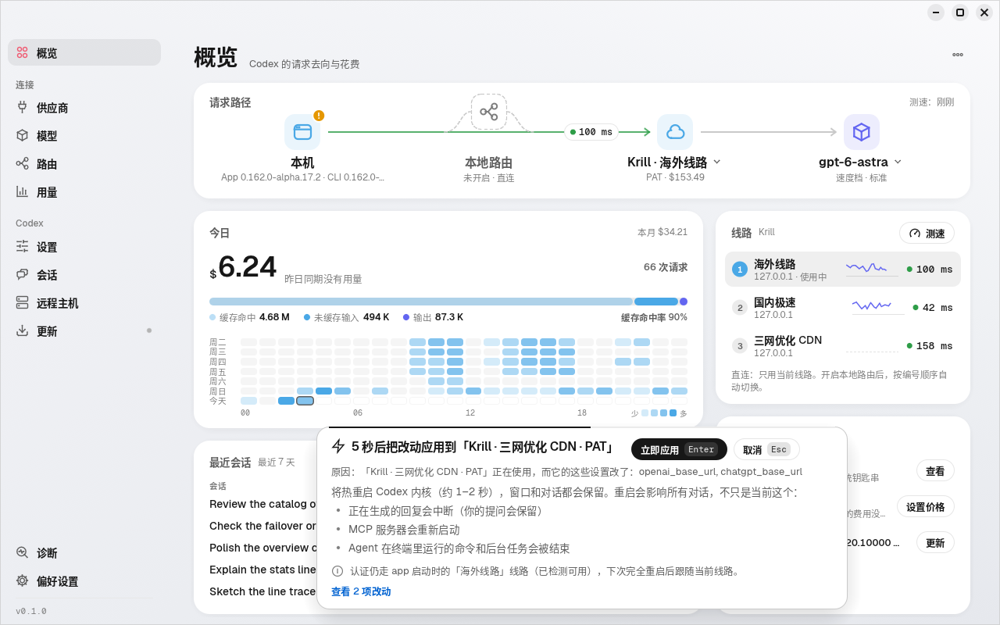
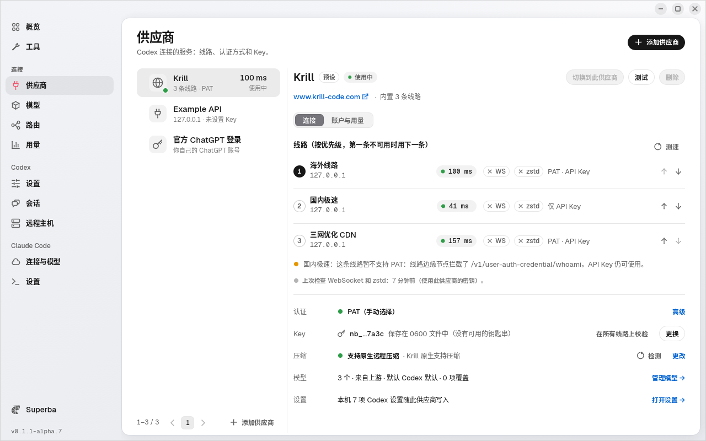
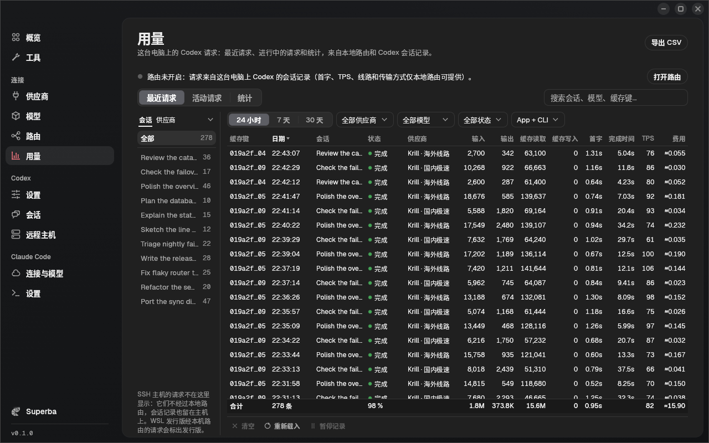
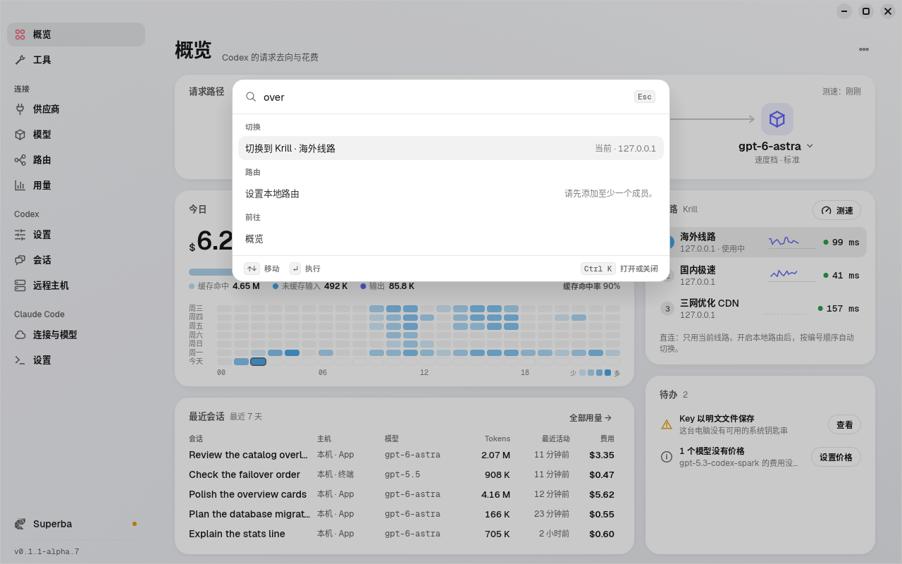
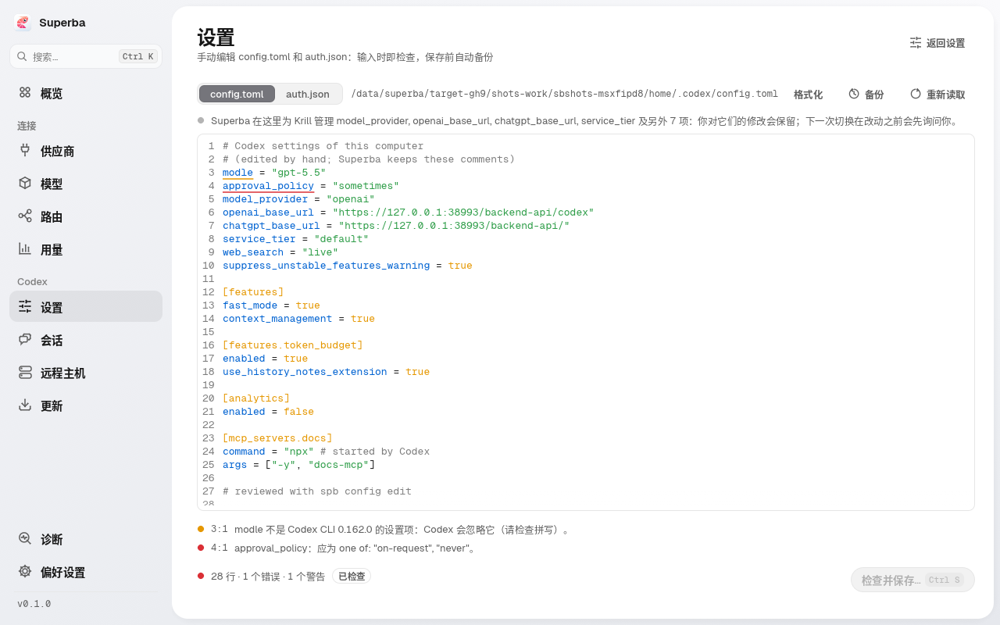
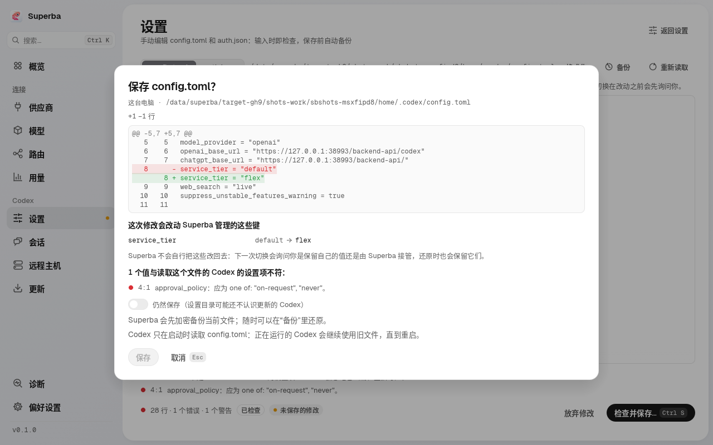

<p align="center"></p>

# Superba

[English](README.md) · **简体中文**

Superba 是一个小巧的桌面启动器（附带无界面 CLI），用来把
[OpenAI Codex](https://github.com/openai/codex) —— ChatGPT / Codex 桌面 app、
`codex` 命令行，以及 app 连接的 SSH 远程主机 —— 指向
[Krill](https://www.krill-code.com) 中转站、任意兼容 OpenAI Responses API 的站点，
或者还原回你自己的 ChatGPT 官方登录。切换线路和认证方式时**不用关闭 app**，
会话列表保持可见，随时可以把一切原样还原。

支持 macOS、Linux 和 Windows，用 Rust 编写（egui 界面，Vercel Geist 风格）。



| 热切换前的倒计时 | 供应商：线路、认证方式、Key |
|---|---|
|  |  |
| **用量与花费（Krill）** | **命令面板（Cmd/Ctrl+K）** |
|  |  |

> 截图由真实程序在隔离的主目录和本地模拟中转站上运行生成
> （`crates/superba-gui/tools/screenshots/shoot.py`），其中的账户、Key 和用量均为虚构数据。

## 功能

- **热切换。** app 运行中直接换线路（Krill：国内极速、海外线路、三网优化 CDN）
  或换认证方式：app 内部的 Codex 核心约 1 秒重启，窗口、正在看的对话和最近
  列表都保留，下一轮直接走新线路并带上完整历史。
- **自动选择认证方式。** Krill 的 Key 能用作个人访问令牌（PAT）时就用 PAT，否则
  用普通 API Key：线路边缘拦截了 PAT 端点、线路是明文 http、设置了自定义 base URL、
  通过本地路由，或者已安装的 Codex（app 自带的或 CLI）版本太旧不支持 PAT 时，都会
  改用 API Key，并始终说明原因。在“高级”里仍可固定为 PAT 或 API Key。
- **配置 = 连接 + Codex 设置。** 一个配置包括站点、按优先级排列的线路（第一条
  不可用时用下一条）、认证方式和 Key，以及 Superba 为它管理的 `config.toml` 设置。
  设置项来自按每个 Codex 版本自己的 schema 和功能列表生成的目录（英文说明取自官方，
  中文说明由人工撰写），会按读取该配置的各个 Codex 版本（app、CLI、每台远程主机）
  检查；每次切换都会预览每个改动的键及原因。
- **任意兼容 OpenAI 的站点。** 用 base URL 添加 Responses API 站点，把 Codex 的模型名
  映射到站点上的名称，切换前先检测（延迟、Key、模型列表、一次 Responses 请求）。
- **从 cc-switch 和 AI Toolbox 导入。** 导入它们的 Codex 供应商（Krill 线路变成 Krill 预设，
  其他站点变成带线路的自定义站点），保存前先预览冲突和 Key；也能把它们记录的 Codex
  用量历史导入用量页面；它们的文件只读不写。
- **按供应商的远程压缩。** Superba 知道每个供应商能否压缩 Codex 对话（检测得出，或由你设置），
  切换到不能压缩、或读不了其他供应商压缩过的对话的供应商前会提示；本地路由会把压缩过的对话
  留在执行压缩的那个供应商。
- **模型与速度档。** 模型页（以及 `spb models`）列出供应商的模型及其上下文窗口和
  自动压缩上限，可按模型覆盖（区分默认值与自定义值，带校验，可重置）；标准 / Fast /
  Ultrafast 速度档控件会说明每个档位对终端和桌面 app 各自的效果。
- **Codex 与 app 版本。** 更新页（以及 `spb codex`、`spb app`）显示 app、CLI 和每台
  远程主机运行的 Codex，安装经校验的 Codex 版本，可把桌面 app 固定在某个 Codex 版本，
  并检查 ChatGPT 桌面 app 是否有新版本（只显示安装命令，不会替你执行）。
- **Superba 自身更新，由你点头。** 更新页、概览待办、侧栏小圆点和 `spb self-update check`
  会告诉你有新版 Superba；点“立即更新”或运行 `spb self-update install --yes` 会下载适合
  本系统的安装包，对照该版本的 `SHA256SUMS.txt` 校验大小和 SHA-256，原地替换 Superba
  （macOS 替换应用包，Windows 运行新版 MSI，Linux 替换二进制；目录不可写时给出手动
  步骤），并在本地路由器服务运行时重启它。自动检查（启动时及每 24 小时）和更新通道
  （稳定版，或包含 alpha、beta、候选版的预览版；预览版构建默认使用预览版通道）都在
  偏好设置里；不会提供比当前更旧的版本，没有你的点击不会安装任何东西。
- **账户与用量。** 任何用 Key 的站点都通过标准计费接口显示余额、套餐和到期时间；
  Krill 还会显示账户邮箱、每日费用和按模型的用量（按需获取：Krill 每小时只允许
  10 次用量查询）。
- **本地路由（可选，默认关闭）。** 一个只监听 `127.0.0.1` 的本用户后台进程，把本机
  Codex 的请求转发到 Krill 各线路和你的其他站点，按请求故障切换并保持会话粘性。开启
  后你的流量会经过这个本地进程。ChatGPT 官方登录从不经过路由，远程主机始终直连；
  Superba（或 `spb router watch`）运行期间路由进程挂掉时，会把 Codex 切回直连线路。
- **用量。** **用量**页面和 `spb usage` 显示最近请求（类似 Surge 的请求列表：会话名、
  供应商、token、缓存、费用）和统计，不开路由也可用：Superba 只读 Codex 写在会话记录里
  的用量（只有数字）。开启路由后，请求还会带首字、TPS、应答的线路和传输方式，并且只列一次。
- **默认安全。** 每次切换先出计划（看计划时不写任何文件），5 秒倒计时内按 Esc
  即可取消；执行过程写日志（journal），完成后校验（新核心进程、文件哈希、认证
  与线路检查、窗口状态），校验失败自动回滚。
- **等你的回合跑完。** 核心重启会让进行中的回合丢失回答，Superba 默认等回合
  结束（或询问你）再重启。
- **还原。** 回到*原始配置*（其他内容没变时逐字节一致）、回到*ChatGPT 官方登录*
  （Superba 第一次替换它时已加密暂存），或回到任意一次之前的切换。
- **会话 provider 迁移。** app 只显示 provider 与当前一致的会话。用过旧版 Krill
  教程（`model_provider = "krill"`）的用户可以把这些会话迁移到 `openai`（也可以
  迁回去），带备份、迁移账本和精确回滚。迁移时终端和编辑器里的 Codex 需要关闭；
  Superba 会列出它们，你同意后可以代为停止（先请求退出，强制结束前会再问一次；
  命令行用 `spb … --stop-codex [--force]`）。
- **远程主机。** app 已连接的 SSH 主机可以和本机一起切换（使用系统自带 `ssh`，
  Key 只通过 stdin 传输）。
- **通用模式。** 任何兼容 OpenAI Responses API 的站点都可以用 base URL 添加。
- **实际生效的配置。** Codex 只在启动时读取配置。Superba 会逐个列出正在运行的
  Codex（桌面 app 的内核、每个终端里的 codex、`codex exec`、VS Code / Cursor 的
  编辑器扩展）：它已经在用新写入的配置，还是仍在用之前的配置；里面是否有正在运行的
  回合；以及怎样切过去——app 内核由 Superba 重启，终端和编辑器给出具体操作
  （`codex resume --last`、“Developer: Restart Extension Host”，编辑器不会被关闭）。
  显示在概览的待办、每次切换之后和 `spb status` 中。
- **手动编辑 Codex 的文件。** 设置 → **编辑 Codex 文件**（以及 `spb config edit`）可以编辑
  本机、远程主机或 WSL 发行版上的 `config.toml` 和 `auth.json`：TOML / JSON 高亮，每次按键都按
  读取该文件的 Codex 版本的设置项检查，格式化不丢注释，`auth.json` 里的密钥在你选择显示之前一直
  隐藏，保存前显示差异，并加密保留被替换的每个版本。
- **诊断。** 发现过期的 Codex 进程、外来的环境变量、无法解析的配置、钥匙串问题等。
- 中英文界面。

## 安装

发布页提供以下预编译包：

| 平台 | 文件 |
|---|---|
| macOS 11+（Apple 芯片和 Intel） | `superba-<版本>-macos-universal.dmg` / `.zip` —— 已签名并公证的 `Superba.app` 以及 `spb` |
| Linux x86_64 / aarch64（glibc） | `superba-<版本>-linux-<架构>.tar.gz`（`superba`、`spb`、`superba-router`） |
| Linux x86_64，仅 CLI（musl 静态） | `spb-<版本>-linux-x86_64-musl.tar.gz`（`spb`、`superba-router`） |
| Windows 10+ x86_64 | `superba-<版本>-windows-x86_64.msi` —— 本用户安装包（`superba.exe`、`spb.exe`、`superba-router.exe`） |

Windows 上直接运行 `.msi`（无需管理员权限）：安装到 `%LOCALAPPDATA%\Programs\Superba`，
创建开始菜单快捷方式，并把 `spb` 加入当前用户的 `PATH`（装完请新开终端）。新版 `.msi`
原地升级；在“设置 > 应用”（或 `msiexec /x`）卸载时，会同时停止并移除本地路由器的开机
启动项。Windows 不再提供 zip。静默安装：
`msiexec /i superba-<版本>-windows-x86_64.msi /qn`。MSI 里还带有 `spb-linux-x86_64`：
静态链接的 Linux 版 `spb`，Superba 在 WSL 发行版内迁移会话时运行它。

`superba-router` 是可选的本地路由程序，请和 `superba`、`spb` 放在一起（macOS 上
它在 `Superba.app` 内部，开启路由前请先把 app 移到“应用程序”文件夹）。每个版本附带
`SHA256SUMS.txt`。从源码构建见[构建](#构建)。

## 快速开始（Krill）

1. 在 <https://www.krill-code.com> 获取 Key。
2. 打开 **Superba**。首次启动向导会检测桌面 app 和 CLI，展示当前配置（以及旧的
   `krill` 会话），填写 Key 并测速线路；认证方式自动选择（线路支持 PAT 时用 PAT，
   否则用 API Key，并说明原因）。
3. 确认后点 **切换**。如果桌面 app 正在运行但不是 Superba 启动的，Superba 会
   提出完整重启一次，之后就可以热切换了（见下文）。
4. 之后在概览页点另一条线路（或按 Cmd/Ctrl+K 输入线路名），倒计时结束后原地切换。

用 CLI 完成同样的事：

```sh
# Key 存进系统钥匙串（从 stdin 读取，不会出现在命令行参数里）
# 认证方式自动选择：线路支持时用 PAT，否则用 API Key（并说明原因）
spb profile add krill --line overseas --line cdn --key-stdin
spb lines --probe                 # 各线路延迟以及 PAT / API Key 是否可用
spb switch --profile krill        # 计划、倒计时、切换、校验
spb launch                        # 通过 Superba（重新）打开桌面 app
spb switch --line cdn             # 之后：热切换到另一条线路
spb account --usage               # Key 的余额、套餐、到期时间和近期用量
spb settings list                 # 本机的 Codex 设置（config.toml，来自 Codex 自己的 schema）
```

其他兼容 OpenAI 的站点：

```sh
spb site add myapi --name "My API" --base-url https://api.example.com/v1 \
  --map gpt-5.5=vendor/gpt-5.5    # 可选：Codex 模型在该站点上的名称
spb profile add myapi --site myapi --key-stdin
spb site probe myapi --profile myapi --responses   # 延迟、Key、模型列表、一次 Responses 请求
spb switch --profile myapi
```

回到原来的样子：

```sh
spb restore original              # Superba 接管前的配置（最近一次接管）
spb restore official              # 你的 ChatGPT 登录（加密暂存）
spb restore generation --generation 3
spb uninstall                     # 还原并移除 Superba 写入的 shell 配置块
```

## 从 cc-switch 和 AI Toolbox 导入

已经在 [cc-switch](https://github.com/farion1231/cc-switch) 或
[AI Toolbox](https://github.com/coulsontl/ai-toolbox) 里配置过 Codex 供应商？用
**供应商 > 添加 > 从其他工具导入**（首次运行向导的供应商一步和命令面板里也有）或
`spb import`，读取它们的配置，把其中的 Codex 供应商导入 Superba。

- **只读。** Superba 只读取另一个工具的存储（即使它正在运行），从不写入：cc-switch 的
  `~/.cc-switch/cc-switch.db`（数据库版本 1 至 20；或更早的 `config.json`），AI Toolbox
  应用数据目录下的 `ai-toolbox.db`（数据库版本 4 至 29），并遵循它们自己的数据目录设置。
  未知版本或格式的存储（AI Toolbox 0.9.2 之前的 SurrealDB 目录）会跳过并说明原因。
- **导入成什么。** 地址是 Krill 线路的，导入为该线路上的 Krill 预设；其他地址导入为
  自定义 OpenAI 兼容站点，带上 base URL、线路（该工具里的备用地址）、模型、推理强度和
  模型映射。Key 存入 Superba 的 Key 存储（系统钥匙串）。Claude Code、Gemini 等非 Codex
  供应商、ChatGPT 登录，以及只能经由另一个工具本地代理使用的供应商，会列为不可导入并说明原因。
- **先预览。** 每个供应商都显示它会变成什么、Key 是否一起导入，以及与已有供应商的冲突
  （同名或同地址）：跳过（默认）、重命名（与已有的并存导入）或更新（Key、地址或线路、模型；
  名称和 Codex 设置保持不变）。不会写入 Codex，也不会重启：想用时再切换到导入的供应商。

```sh
spb import ccs --dry-run                     # 将导入什么，不写入任何内容
spb import ai-toolbox --select "My Relay,Krill" --on-conflict rename
spb import ccs --json                        # 存储、预览和结果
```

另一个工具存放在系统钥匙串里、或从环境变量读取的 Key 不会被复制：该供应商导入时不带 Key，
并附有说明，之后在 Superba 里补上 Key 即可。

### 用量记录

同一个对话框里会按工具显示它记录的 Codex 用量历史（它本地代理的请求记录，以及它为较早
日期保存的每日汇总）：请求数、时间范围和该工具记录的费用；**导入用量记录**把它们复制到
Superba 的用量页面，这些记录会标为“从 CC Switch / AI Toolbox 导入”，可用来源筛选
（`spb import usage` 效果相同）。

- **只读，只导一次。** 只读取该工具的数据库。请求保留该工具自己的 ID，再次导入只会添加新的
  记录。费用保持该工具记录的数值（它没记录费用的请求显示为无费用）；错误文本和提示词从不复制。
  Claude Code 等其他工具的记录只计数、不导入。
- **不会重复。** 两个工具都可能读取 Codex 自己的会话记录，而 Superba 自己也会读取：这类记录
  只在对应会话文件已不存在时才导入（这类每日汇总只导入 Superba 最早会话文件之前的日期）。
- **每日汇总** 对应该工具已不按请求保存的日期；它们计入统计，不出现在请求列表里。
  `--remove` 可把某个工具导入的记录删掉。

```sh
spb import usage ccs --dry-run               # 数量、时间范围、记录的费用；不写入任何内容
spb import usage ai-toolbox                  # 导入（再次导入只添加新的）
spb usage log --since 90d --source ccs       # 查看导入的记录
spb import usage ccs --remove                # 删除导入的记录
```

## 远程压缩

Codex 压缩长对话时，会带一个 `compaction_trigger` 项把对话发给服务商（HTTP 或 WebSocket），
并用服务商返回的唯一一个加密 `compaction` 项代替旧的历史；之后只有这个服务商能读取它。对
Superba 所配置的 provider（`openai`），Codex 总是这样压缩，没有改用本地压缩的设置（那个开关
只对自定义 provider ID 有效，而 Superba 从不写自定义 provider，因为 Codex 按 provider ID
列出会话）。

- **按供应商。** 连接页显示供应商是否原生支持压缩、不支持，或尚未检测。**检测** 会按 Codex
  的方式发一次极小的压缩请求（消耗少量 token）；尚无任何信息的自定义站点在打开时会检测一次
  （一周后再测，结果不明确时一天后再测）。Krill 原生支持压缩。**更改** 可覆盖检测结果
  （自动 / 原生 / 不支持）；`spb profile compaction <id> [--check]` 和
  `spb profile edit <id> --compaction auto|native|unsupported` 作用相同。
- **直连模式。** 原生支持的服务商，请求原样透传。切换到不支持压缩的服务商前，预览会说明
  （对话占满上下文窗口时无法在那里压缩：请新开对话），并统计最近 7 天里由其他站点的服务商
  压缩过的对话：在新服务商上继续这些对话会失败或丢失上下文。
- **路由模式。** 压缩请求会跳过不能压缩的成员（交给能压缩的成员，对话随后留在那里）；压缩过
  的对话只发给生成其压缩项的成员，不会故障转移到其他成员（该成员不可用时返回
  `compaction_owner_unavailable`）；没有可用成员时，路由直接返回带说明的
  `compaction_unsupported`。WebSocket 会话会自动重连到正确的成员。路由只保存压缩项的指纹和
  成员 ID（`router/compactions.json`），从不保存内容。

## 与 cc-switch、AI Toolbox 一起使用

Superba 只拥有它最近一次切换写入的内容：[Superba 会改动什么](#superba-会改动什么) 里列出的
`config.toml` 键、`auth.json` 里的凭据，以及它设置的 `CODEX_AUTHAPI_BASE_URL`。之后如果有别的
程序改了其中任何一项（cc-switch 或 AI Toolbox 把 Codex 切到它们的供应商、Codex 应用的模型选择器、
`codex login`、手动编辑），Superba 会发现，并且不经询问绝不覆盖：

- **启动时、每次写入前、窗口打开期间都会检查。** 概览的待办里会列出这次修改并带有**查看**按钮，
  每出现一种新的文件状态会弹出一次对话框：最可能是谁改的（能从 cc-switch 或 AI Toolbox 自己的
  存储或它们写入的标记判断时，会写出工具名和供应商名，否则是“Codex 自己的登录”“Codex 应用或手动
  修改”或“其他程序或手动修改”）、每个被改的键在 Superba 写入时和现在的值，以及凭据的变化
  （`PAT …1111 → 没有 auth.json`；永远不显示 Key 本身）。`spb status` 和 `spb doctor` 也会显示。
- **重新接管、交给另一个工具管理，或暂不处理。** *重新接管* 用你的配置方案覆盖这些修改（照常显示
  计划和倒计时）；*交给 cc-switch 管理* 即下面的交接；*暂不处理* 什么都不改。存在这类修改时发起的
  切换也会问同样的问题（Esc 取消，不写入任何内容）；命令行用 `spb switch --take-over` 回答，在终端里
  `spb` 会直接询问。
- **还原绝不撤销其他工具的修改。** 还原（原始配置、官方登录或某一代）、卸载以及路由器的自动回退
  只还原 Superba 仍在管理的内容，并列出保留了什么、为什么；`spb restore --take-over` /
  `spb uninstall --take-over` 会连这些键一起还原。退出 Superba 不会写入任何内容。
- **交接。** *交给……管理*（或 `spb hand-off`）让 Superba 不再管理 Codex：它仍拥有的键恢复为你原来
  的样子（例如 cc-switch 不管理的 `chatgpt_base_url`，留着会把 ChatGPT 流量发到 Krill），其他工具改过的
  内容全部保留，它设置的 `CODEX_AUTHAPI_BASE_URL` 在没被别人改动的位置移除，两份文件的加密副本随
  历史代数保存。不重启任何程序，也不迁移会话。之后 Superba 不再拥有任何内容，概览显示“由 cc-switch
  管理”；以后切换到任一配置方案会从新的基线重新接管，因此再还原时得到的是另一个工具的配置。

```sh
spb status                       # 哪些内容在 Superba 之外被改了，最可能是谁改的
spb switch --take-over           # 用配置方案覆盖这些修改
spb hand-off [--to cc-switch|ai-toolbox|other]   # 交给另一个工具管理 Codex
spb restore --take-over          # 还原原始配置，连其他工具改过的地方一起还原
```

Superba 读取其他工具的存储只是为了判断是谁做的修改，从不写入；也不支持两个工具同时管理同一组键：
请选择交接或接管。

## 手动编辑 config.toml 和 auth.json

设置 → **编辑 Codex 文件**（命令面板里也有：*编辑 config.toml*、*编辑 auth.json*、*从备份还原
config.toml*）直接编辑 Codex 自己的文件；用**位置**菜单可以切换到 Superba 管理的远程主机或 WSL 发行版。



- **输入时即检查。** TOML 或 JSON 语法错误会带行号和列号标出下划线，这样的文件不能保存（Codex
  无法用它启动）。`config.toml` 还会按读取它的每个 Codex（本机是 app 自带的 Codex 和 CLI，远程主机
  是那台主机上的 Codex）的设置目录检查：值的类型不对是错误，仍可选择*仍然保存*（设置目录可能还不认识
  更新的 Codex）；没有任何 Codex 认识的键、已弃用的键和旧名称是警告。`auth.json` 会检查 Codex 读取
  的字段。点一下问题即可跳到对应位置。
- **格式化**只整理空格和空行；注释、值以及它们的顺序保持不变。
- **密钥保持隐藏。** `auth.json` 里的 API Key、PAT 和登录令牌显示为 `••••••••••••1234`，直到你点
  **显示密钥**；其余内容可以直接编辑而不必显示密钥，只改了一部分的占位符会被拒绝。密钥不会出现在日志、
  差异（除非选择显示）或 `--json` 输出里。
- **检查并保存**（Ctrl/Cmd+S）显示差异，以及这次修改会改动哪些 Superba 管理的键；只有文件仍是你打开
  时的样子才会保存，并且会先加密备份被替换的文件（每个文件保留最近 50 份）。
- **你的修改归你。** 你改过的、由 Superba 管理的键就是你的值：Superba 不会自行改回去，下一次切换会询问
  你是保留还是由 Superba 接管，还原时也会保留（与在 Superba 之外做的任何修改一样，见上文；概览里会把它
  列为你的修改）。
- **哪些需要重启。** Codex 只在启动时读取这些文件；保存后 Superba 会列出仍在使用旧文件的每个正在运行的
  Codex，**Codex 生效情况**会说明它们各自怎样用上新文件。
- **备份。** 列出这个文件的每一份备份（编辑器保存前的、Superba 每次切换前保留的，以及 Superba 首次写入
  之前的原始文件），每份都可以查看与编辑器内容的差异；还原某一份就像保存一次编辑，同样会先备份当前文件。



```sh
spb config edit [config|auth] [--host H]   # 用 $VISUAL / $EDITOR（Windows 上为记事本）编辑，关闭编辑器后检查
spb config check [config|auth]             # 按原样检查文件
spb config backups [--file config|auth]    # 列出每份备份的 id、时间和来源
spb config restore <id>                    # 先看差异，再还原
```

`spb config edit` 打开的是一份私有副本，编辑器关闭后检查（遇到语法错误会询问是否重新编辑），显示差异
（除非加 `--show-secrets`，否则密钥会被隐藏），保存前先询问（`--yes` 跳过询问，`--force` 允许保存
类型不对的值）。

## 热切换的原理

Codex 只在 app-server 进程启动时读取 `config.toml`、`auth.json` 和环境变量，
所以任何切换都需要重启这个进程。桌面 app 内部有一条“重启 Codex 核心”的消息，
外部能发送它的唯一途径是 Chromium 调试协议（DevTools）。因此：

1. Superba 自己启动桌面 app，并只在本机回环上开调试端口（Linux 和 macOS 用
   `--remote-debugging-port=0`，再从 `DevToolsActivePort` 读出实际端口；Windows
   预留一个空闲端口），`--remote-allow-origins` 限定为这个地址，记录端口。
2. 切换时，Superba 原子地写入 `config.toml` 和 `auth.json` 中它负责的键（有
   journal），确认端口确实属于 app 进程后，请 app 的渲染进程重启 Codex 核心。
3. Superba 校验：新核心进程已启动、文件就是它写的内容、Key 在该线路可用、
   窗口没有掉回登录页。否则回滚并再次重启核心。

限制：

- 只有 Superba 启动的 app 才能热切换。否则第一次切换是**完整重启**（退出再打开），
  之后即可热切换。
- 有些变化必须完整重启：在 ChatGPT 登录和 Key 之间切换；PAT 模式下线路的认证地址
  与 app 启动时不同（app 只在启动时读取一次 `CODEX_AUTHAPI_BASE_URL`）；会话迁移
  （必须关闭所有 Codex 进程）。
- 核心重启时正在运行的回合会丢失回答。Superba 默认等待回合结束；`--force` 会打断。
- PAT 需要 `https` 线路，Codex 不接受明文 http 的 ChatGPT 后端。边缘节点拦截了
  PAT 端点的线路（目前是国内极速）会改用 API Key 模式，并说明原因。
- 终端里的 `codex` 会话和 IDE 插件在重启前继续使用旧配置，Superba 会把它们标为过期。
- 热切换已在 Linux（桌面 app 26.10）上验证。macOS 和 Windows 已实现、仍在验证中；
  无法确认重启通道时 Superba 会退回完整重启。
- 调试端口开启期间，以你的身份运行的其他程序，以及多用户机器上的其他本地用户，
  都可以连上它并控制 app。在设置中打开**安全模式**可以不带调试端口启动（不能热切换）。
  以 root 身份运行时从不开调试端口。详见 [SECURITY.md](SECURITY.md)。

## 本地路由（可选）

路由模式默认关闭，需要你主动开启（**路由**页面，或 `spb router enable`）。至少需要
一个成员：一个带自己 Key 的 Krill 或自定义站点配置。

- Superba 把 `superba-router` 安装为本用户服务（Linux：systemd 用户服务，不可用时用
  XDG 自启动；macOS：LaunchAgent；Windows：`HKCU\...\Run` 启动项），只监听
  `127.0.0.1`，并让本机 Codex 以 API Key 模式、用一个随机的本地令牌访问
  `http://127.0.0.1:<端口>/backend-api/codex`。路由校验这个令牌，再用各成员自己的
  Key 把请求发给成员（Krill 的 Key 绝不会发往其他站点）。
- 每个请求先走该会话当前的线路；连接失败、尚未返回任何内容就断开、502/503/504 或
  被边缘节点拦截时，换到该成员的下一条线路，再换下一个成员。401、403、429 及其他
  错误原样返回，从不切换。流式响应（SSE、WebSocket）和压缩请求体原样透传。
- 开启、关闭路由走正常的切换流程并带预览。已安装的路由在增删、调整成员后会重新加载；
  在“安装并启动”（或开启路由）之前，成员列表只会被保存。Codex 经过路由期间，只要
  Superba 窗口或 `spb router watch` 在运行，就会检查路由；连续 20 秒无响应时，Superba
  把 Codex 切回直连线路并关闭路由模式（切换失败会再次尝试）。
- 删除成员配置或为其更换 Key 时，会同步更新路由的 Key 文件。`spb router disable` 回到
  直连；`spb router uninstall`（或 `spb uninstall`）移除服务及其 Key 文件。

路由能看到什么，见 [SECURITY.md](SECURITY.md#the-local-router)。

## Superba 会改动什么

| 对象 | 何时 | 如何还原 |
|---|---|---|
| `~/.codex/config.toml`（或 `$CODEX_HOME`） | 每次切换 | 只改 Superba 负责的键（`model_provider`、`openai_base_url`、`chatgpt_base_url`、配置的模型以及它管理的 Codex 设置）；配置不再管理的键会恢复原值；注释、MCP 服务、插件和其他内容逐字节保留；Superba 写入后被其他程序改过的键会被保留（见上文） |
| `~/.codex/auth.json` | 每次切换 | 以 0600 权限写入；替换前会加密暂存你的 ChatGPT 登录；其他程序放进去的凭据，还原时保留，切换时只有你选择接管才会替换 |
| shell 启动文件 | 仅 PAT 模式 | 一个带标记的块，导出 `CODEX_AUTHAPI_BASE_URL`（Linux：`~/.profile` 和 `~/.config/environment.d/60-superba.conf`，以及已存在或属于你所用 shell 的 `~/.bashrc`、`~/.bash_profile`、`~/.zshenv`（设了 `$ZDOTDIR` 时在其中）、fish `conf.d/superba.fish`；macOS：`~/.zshenv`、同样的 bash / fish 文件，外加 LaunchAgent `~/Library/LaunchAgents/com.krill-code.superba.env.codex-authapi-base-url.plist`；Windows：`HKCU\Environment` 里的用户变量，不写文件）。旧 Krill 教程写的行会被注释掉，之后可还原 |
| `state_5.sqlite`、`thread_history_*.sqlite`、`sessions/**/rollout-*.jsonl` | 仅在迁移会话时 | 备份加迁移账本；`spb sessions rollback <id>` |
| 远程主机的 `~/.codex` 和 shell 文件 | 仅限你选中的主机 | 在主机上按次备份；`spb remote rollback <目标>` |
| 路由服务（Linux：`~/.config/systemd/user/superba-router.service`；macOS：`~/Library/LaunchAgents/com.krill.superba.router.plist`；Windows：`HKCU\Software\Microsoft\Windows\CurrentVersion\Run` 下的 `SuperbaRouter` 启动项） | 仅在安装了本地路由时 | `spb router uninstall` / `spb uninstall` |
| 你在 Superba 里编辑的 `config.toml` / `auth.json`（本机、远程主机或 WSL） | 仅在你保存编辑或还原备份时 | 被替换的文件会先加密备份到数据目录（`backups/editor/`，每个文件保留最近 50 份）；设置 → 编辑 Codex 文件 → 备份，或 `spb config restore <id>` |
| cc-switch / AI Toolbox 的存储 | 仅在从它们导入时 | 只读，从不写入（有未落盘改动的数据库会先复制到 Superba 缓存里的私有副本再读，读完即删） |
| Superba 数据目录 | 始终 | `~/.local/share/superba`（Linux；设了 `$XDG_DATA_HOME` 时为 `$XDG_DATA_HOME/superba`）、`~/Library/Application Support/com.krill-code.Superba`（macOS）、`%LOCALAPPDATA%\krill-code\Superba\data`（Windows：本地、不漫游的用户目录）；可用 `SUPERBA_DATA_DIR` 覆盖 |

你交给 Superba 的 Key 存在系统钥匙串（Keychain、凭据管理器、Secret Service）中；
没有钥匙串时存在数据目录下权限为 0600 的文件里。登录和文件的备份用
ChaCha20-Poly1305 加密。

切换中途被打断（崩溃、断电）时，Superba 下次启动会把它完成或回滚
（也可以手动运行 `spb recover`）。

## CLI 参考

`spb` 是无界面 CLI；`superba <命令>` 的行为完全相同。所有命令都支持 `--json`
（stdout 恰好输出一个 JSON 文档）和 `--locale en|zh-CN`。

| 命令 | 用途 |
|---|---|
| `spb status` | 当前配置、桌面 app（安装、CDP、认证地址）、CLI 进程、远程主机 |
| `spb lines [--site ID] [--probe]` | 线路及其延迟 / PAT / API Key / 边缘拦截状态 |
| `spb key set --profile P (--stdin \| --key-env VAR)` / `spb key check` | 保存或检查 Key |
| `spb profile list \| add \| edit \| remove \| use` | 命名配置（站点、线路顺序、认证：自动 / PAT / API Key、Key 引用、模型、`--compaction auto\|native\|unsupported`） |
| `spb profile compaction ID [--check]` | 服务商的远程压缩能力（`--check` 会向服务商检测，消耗少量 token） |
| `spb site list \| add \| edit \| remove \| probe` | 内置站点和兼容 OpenAI 的站点、模型映射、线路和 Key 检测 |
| `spb switch [--profile P] [--line L] [--auth pat\|apikey]` | 计划并执行切换（预览会列出每个改动的键及原因） |
| `spb settings list \| get \| set \| reset \| forget \| migrate \| diff` | 本机的 Codex 设置（`config.toml`）；修改保存在当前应用的供应商中，`--profile` 查看或修改某个供应商自己的设置；按已安装的 Codex 版本检查 |
| `spb router status \| install \| enable \| disable \| uninstall \| watch` | 可选的本地路由：在线路和站点之间故障切换，只作用于本机 |
| `spb usage [log] [--provider P] [--source router\|rollout\|ccs\|ai-toolbox]` / `spb usage stats [--by model\|provider\|day\|session] [--source …]` | 这台电脑上的 Codex 请求（路由的请求记录合并 Codex 会话记录，不开路由也可用）；按供应商（Krill、每个自定义站点）汇总，并列出其各条线路 |
| `spb account [--usage] [--days N] [--refresh]` | 余额、套餐和到期时间；每日费用和按模型的用量（Krill） |
| `spb restore [original\|official\|generation] [--take-over]` | 还原（其他工具改过的内容默认保留，`--take-over` 才一并还原） |
| `spb hand-off [--to cc-switch\|ai-toolbox\|other]` | 交给另一个工具管理 Codex：释放 Superba 拥有的内容，保留其他工具的修改并留有备份 |
| `spb launch [--restart]` | 通过 Superba 打开（或完整重启）桌面 app |
| `spb sessions [scan \| migrate --from krill \| rollback ID]` | 会话 provider |
| `spb remote list \| apply \| rollback` | SSH 远程主机 |
| `spb import ccs\|ai-toolbox [--dry-run] [--select 名称] [--on-conflict skip\|rename\|update]` | 从 cc-switch 或 AI Toolbox 导入 Codex 供应商（只读取它们的文件，不改动 Codex） |
| `spb import usage ccs\|ai-toolbox [--dry-run] [--remove]` | 把 cc-switch 或 AI Toolbox 记录的 Codex 用量历史导入用量页面（只读；每条请求只导入一次） |
| `spb config edit [config\|auth] [--host H] [--yes] [--force] [--show-secrets]` | 在 `$VISUAL` / `$EDITOR` 里手动编辑 Codex 的 `config.toml` / `auth.json`：关闭编辑器后检查、显示差异、保存前备份 |
| `spb config check \| backups \| restore ID` | 按原样检查文件；列出全部备份；还原其中一份（先看差异） |
| `spb doctor`、`spb recover`、`spb uninstall` | 诊断、崩溃恢复、彻底移除 |

`spb switch --take-over`（`profile use` 同样可用）接管其他工具改过的键和凭据；`--keep-key PATH`
单独保留某一个。

执行计划的命令常用参数：`--dry-run`（只显示计划）、`--countdown N`（0–30 秒，
Ctrl-C 取消）、`--yes`（确认完整重启）、`--wait-turn` / `--force`（处理进行中的
回合）、`--write-only`（只写文件，不重启任何东西）、`--remote 目标` / `--no-local`。

退出码：`0` 完成，`1` 出错，`2` 用法错误，`3` 被阻止，`4` 需要回答或确认，
`5` 已取消。

环境变量：`SUPERBA_DATA_DIR`（数据目录）、`SUPERBA_LOCALE`、`SUPERBA_APP_PATH`
（指定桌面 app 安装位置）、`SUPERBA_APP_ARGS`（额外的 app 启动参数）、
`SUPERBA_SECRET_BACKEND=keyring|file|auto`、`CODEX_HOME`、`VISUAL` / `EDITOR`
（`spb config edit`）。

## Krill

[Krill](https://www.krill-code.com) 是 Superba 的主要站点：它的线路、PAT / API Key
两种模式、线路探测以及 whoami / 账户检查都已内置。账户、Key、套餐和计费请访问
<https://www.krill-code.com>。Superba 同样支持任何兼容 OpenAI Responses API 的站点
和 ChatGPT 官方登录。

## 构建

需要 Rust 1.98 或更新版本和 C 编译器（SQLite、zstd 和 TLS 库从源码编译）。
Linux 上的 GUI 还需要常见的 X11 / Wayland 开发包：

```sh
sudo apt-get install -y libxkbcommon-dev libwayland-dev libxcb-render0-dev \
  libxcb-shape0-dev libxcb-xfixes0-dev libgl1-mesa-dev pkg-config
```

```sh
cargo build --release              # 生成 target/release/superba、spb 和 superba-router
cargo build --release -p superba-cli -p superba-router   # 无界面部分，不需要 GUI 库
cargo test --workspace
cargo clippy --workspace --all-targets -- -D warnings
python3 -I crates/superba-gui/tools/screenshots/shoot.py --bin-dir target/release
                                   # 重新生成 docs/screenshots（Xvfb + 模拟中转站）
```

crate 结构和切换流程见 [ARCHITECTURE.md](ARCHITECTURE.md)，提交修改前请阅读
[CONTRIBUTING.md](CONTRIBUTING.md)。发布打包和 macOS 签名见
[scripts/release/README.md](scripts/release/README.md)。

## 许可证

可任选 [Apache License 2.0](LICENSE-APACHE) 或 [MIT 许可证](LICENSE-MIT)。
内置的 Geist 字体使用 SIL Open Font License 1.1
（`crates/superba-gui/assets/fonts/LICENSE-Geist-OFL.txt`）。

Superba 是独立项目，与 OpenAI 无关联，也未获其认可。“ChatGPT”“Codex”“OpenAI”
是 OpenAI 的商标。
