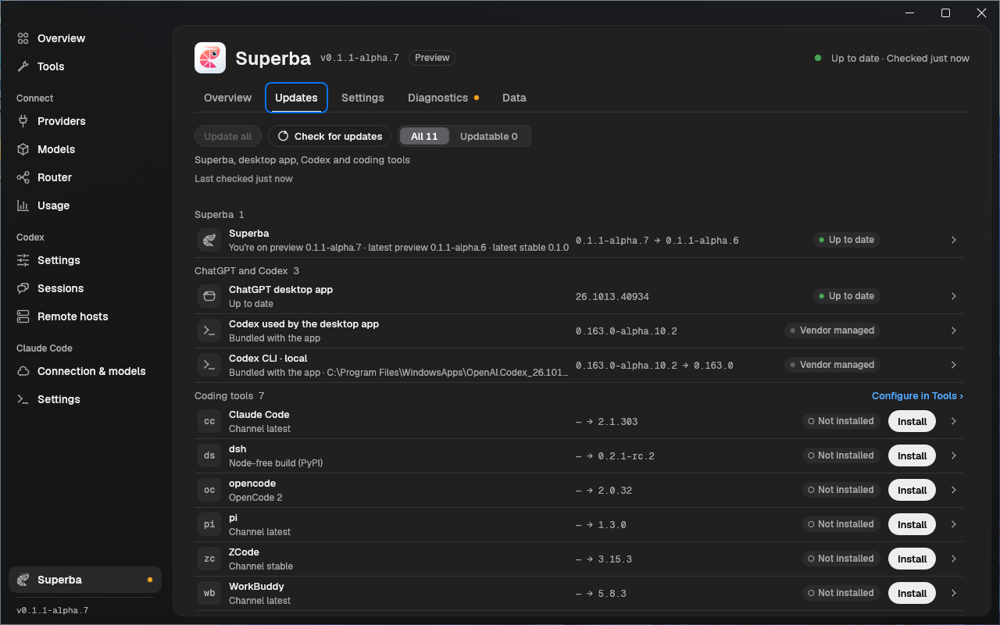
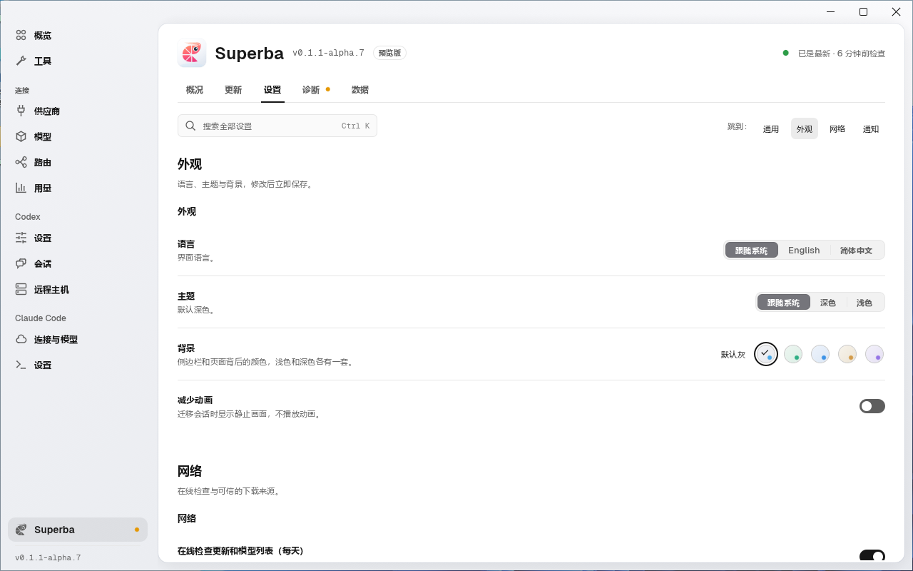

# Documentation screenshots

These 120 screenshots show Superba **0.1.1-alpha.7**, built from
[`92e65caf80569eee09d4732d35304b4e8200c381`](https://github.com/krill-lab/superba/commit/92e65caf80569eee09d4732d35304b4e8200c381).
[manifest.json](manifest.json) records the source tree, Linux binary hashes,
MSI SHA256 and every PNG's SHA256 and dimensions.

The real application runs with synthetic profiles and usage records. Fixture
credentials do not authenticate to a real service. Linux uses an isolated HOME
and process namespace; Windows uses a disposable VM and a dedicated SuperbaDemo
data directory. All frames were reviewed for private data and page content.
Images are not retouched.

The Superba page has five tabs: Overview, Updates, Settings, Diagnostics and Data.
General, Appearance, Network and Notifications are jump destinations on the same
scrolling Settings page. The main sidebar's Codex Settings page remains separate.

| Set | Capture tool | Coverage |
| --- | --- | --- |
| Linux: 88 images (this directory) | `crates/superba-gui/tools/screenshots/shoot.py` and `codex_files_shots.py` | 19 destinations, actions, palette, wizard and Codex file editor; English/Chinese and light/dark |
| Windows: 32 images ([windows/](windows/)) | `e2e/windows/screenshots.py` | Eight Superba destinations; English/Chinese and light/dark |

All screenshots use a 1280×800 application window. The Windows run also completed
16 navigation checks at 960×640. Top-tab selection is verified through UIA.
Settings jump buttons do not expose `selected` through UIA: those assertions remain
**WARN**, while heading position and stability are verified. This capture does
not replace the full Windows test matrix.

| Windows Updates | Windows Appearance |
| --- | --- |
|  |  |

Linux uses a development build. The MSI uses the local quick build profile
(no LTO, 16 codegen units, incremental compilation disabled); it is not a CI
release artifact. Both builds use the source commit above.

The Windows capture command requires the MSI's full source commit and records its
SHA256 with the screenshot hashes in an external evidence directory. Reproduce
using [the Windows harness](../../e2e/windows/README.md#documentation-screenshots).
Keep Linux filenames stable for the README links and put Windows frames in their
own subdirectory. Review new raw frames before replacing this set.
